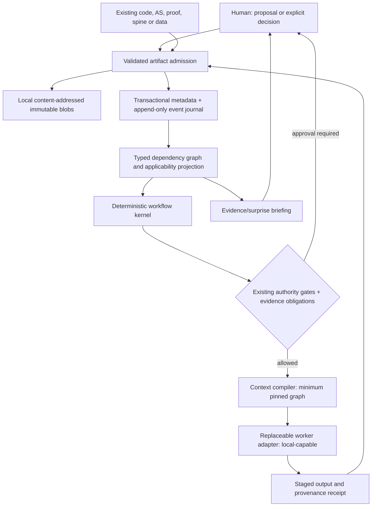

# ARCHBOT-HARNESS-ARCHITECTURE-001: offline project-owned harness (bounded design)

**Status:** ARCHITECTURE PROPOSAL, NOT ACCEPTED OR IMPLEMENTED.
**Source:** human architectural input `ARCHBOT-HARNESS-ARCHITECTURE-001`
(2026-10-24), reconciled to the existing
[Orchestrator and Human Attention proposal](PROCESS_ORCHESTRATOR_HUMAN_ATTENTION_PROPOSAL.md)
and [active roadmaps](../process/roadmaps/CLN001_PROGRESS_AND_HARNESS_001.yaml).
No protected baseline, process gate, reviewed evidence, or original Toy1
sources are migrated or changed by this proposal. Current Stage-12 IF11
independent review is still separately due.

## D01. Source-backed gap analysis (initial inspection)

| Proposed responsibility | Existing source observed | Initial finding, **not full code qualification** | Next discriminating test |
| --- | --- | --- | --- |
| Task execution and context | `tools/task.py`, `tools/task_legacy.py` | PARTIALLY_IMPLEMENTED: current task entry point extends legacy gate mechanisms, but durable general autonomous work is not shown | Kill/restart after task planning and before worker launch |
| Next task routing | `tools/next_task.py` | PARTIALLY_IMPLEMENTED: receipt/rule planning exists; docstring explicitly states it never runs an agent, grants authority or modifies evidence | Invalid/missing authority and ambiguous transition fixtures |
| Project discovery | `framework/core/project_registry.py` | PARTIALLY_IMPLEMENTED: path/name and project-bundle checks exist; not a universal artifact registry | Import existing C file at non-AS entry, without project contamination |
| Historical identity audit | `tools/historical_audit.py` | PARTIALLY_IMPLEMENTED: read-only source/hash audit; not content-addressed artifact storage or general applicability resolver | Changed upstream source and retained historical review |
| Toy1 bootstrap | `tools/cleanroom_pipe_cleaner.py` | PARTIALLY_IMPLEMENTED: specific allowlisted diagnostic packaging; does not verify OS/network/connector isolation | Fresh isolation and no-prior-solution-leakage test |
| Typed gate operations | `process/operations.yaml` and gate policies | PARTIALLY_IMPLEMENTED: role/playbook registry; general event-sourced workflow is unverified | Replay original receipts to precise next eligible gate |
| Reviewer modes | `docs/REVIEW_EXECUTION_MODES.md` | DOCUMENTED_TWO_MODES, not universal independent-launch qualification | Fail before first reviewer turn, ensure no fabricated acceptance |
| Spine composition | Existing spines/OKF and `PROJECT_SPINE.md` | UNKNOWN general imported-spine composition and dependency invalidation | Import two component spines; derive metaspine without altering source |
| Local artifact registry, atomic state journal, offline worker plugin | No comprehensive qualification found in inspected slices | DESIGNED_ONLY or UNKNOWN, **not a claim of absence** | Focused full-repo inventory before implementation |

**Priority:** Source-of-truth/authority conflict prevention and
durable restart behavior before adding more agent-driven autonomy.
Do not equate a source-file presence or a passing toy test with an
`IMPLEMENTED_AND_QUALIFIED` subsystem. This is a gap *hypothesis*,
not an accepted audit result.

## D02. Proposed reference architecture



**ArtifactRegistry:** content hash, stable ID, lineage, origin and
admission; never infer a decision from a file name.
**KnowledgeGraph:** typed edges and applicability; imported spines
retain their own immutable bytes. Composition creates new derived
metaspine entries, never flattens specialist source.
**WorkflowKernel:** explicit state machine and durable journal.
**ContextCompiler:** deterministic view on accepted, task-relevant
nodes and hashes; no unrestricted repository/history inclusion.
**WorkerRuntime:** local-capable provider-neutral adapter, no required
cloud/GitHub/orchestration service. LLM may propose changes only.
**EvidenceAuthorityEngine:** existing gates and reviewed decisions,
not a newly invented competing approver.

Ownership: the project owns the runner, journal, schemas, local blob
storage and policy interfaces. An LLM has no write authority to
protected artifact/decision state; a validated mutation worker
performs all authorized changes. Separate reviewer execution has
independent input/permission records. A mere new directory does not
prove isolation.

## D03. Proposed artifact admission contract (not accepted)

An incoming artifact is admitted as **data** with independent
dimensions, not by pretending it has passed an engineering stage.

```json
{
  "schema": "proposed-pc-artifact-admission/v0",
  "stable_id": "project/CLN-001/artifact/example",
  "content_identity": {"algorithm": "sha256", "digest": "<validated bytes>"},
  "origin": {"actor_type": "HUMAN|WORKER|IMPORT", "source": "<reference>"},
  "kind": "SOURCE_CODE|PROOF|ARCHITECTURE|REQUIREMENT|SPINE|OTHER",
  "roles": ["POSSIBLE_REQUIREMENT", "EVIDENCE"],
  "maturity": "PROPOSED",
  "authority": {"decision_ref": null, "effective": false},
  "applicability": {"status": "UNASSESSED"},
  "provenance": {"inputs": [], "tool_version": null},
  "typed_relations": [{"predicate": "DEPENDS_ON", "target": "<stable id>"}]
}
```

Canonical admission must validate schema/path/content identity,
application and actor authorization separately, then journal the
result without editing prior bytes. Imported proofs remain proofs
with scoped hypotheses, not accepted theorems by import. External C
code may enter before AS and trigger reverse engineering of actual
obligations without inventing stakeholder authority. Human-origin
alternatives may be submitted at ANY stage; the running worker's
input snapshot remains frozen and the dependent node gets an
applicability/impact event.

## D04. Incremental migration, not a framework rewrite

1. **P0:** focused source/qualification inventory; retain all existing
   FR/AS/VO and Toy1 outcomes. No migration.
2. **P1:** offline, stdlib-based local content-addressed import in
   a disposable store with explicit metadata and append-only journal.
   Show import of a supplied C source, independently authored proof,
   OKF spine and two-spine metaspine composition as **data only**.
3. **P2:** dependency invalidation/impact traversal and deterministic
   context projection with hash manifest. Test late human alternative,
   accepted assumption invalidation and source omission.
4. **P3:** durable workflow state machine adapter around existing
   `task.py` and `next_task.py`. Do not replace approved gates.
   No automatic approvals. Atomic outbox/idempotency required for
   worker dispatch, filesystem commits and subsequent Git export.
5. **P4:** provider-neutral local worker adapter with separately
   authorized launch policy, exact runtime identity and independent
   review. Local/GGUF/etc. model *weights licensing* tracked separately.
6. **P5:** qualified offline fresh-start and already-existing-project
   replay with network disabled, no old Toy1 solution leakage and
   quantitative human-minute/time-to-evidence comparison.

No hard dependency on GitHub, cloud APIs, proprietary runtime,
Node.js or specific model provider. SQLite + local SHA-256 blob files
and Python's standard library are candidate implementation choices,
**not** an accepted build policy. Libraries must remain open-source
and auditable with license inventory.

## D05. Fault-injection and acceptance plan

Required invariants:

- No external operation may be marked completed before durable
  corresponding evidence exists; on ambiguous launch/commit success,
  reconcile rather than duplicate silently.
- A duplicate report is idempotently recognized by immutable
  identity; no second engineering approval is synthesized.
- Independent-review readiness is **not** delegated acceptance,
  theorem proof or target verification.
- Human requirement changes or alternate architecture ideas are
  versioned new artifacts and can suspend only affected tasks.
- Historical reviews remain retrievable after superseding source.
- No working context may cross project boundaries without
  explicit, authorized import; source pin hashes must bind each run.

Fault scenarios: crash before worker launch, crash during execution,
crash after external effect but before journal commit, duplicate
submission, reviewer launch with zero turns, source changes mid-run,
valid human intervention during implementation, imported proof
assumptions invalidated, repeated incomplete artifacts, offline
network denial, and lack of OS isolation. Record actual outcomes,
return codes and recovery. Design passes neither FR-005 nor FR-006
without a distinct qualified review.

## Relation to the current integration/C evidence

The first exploratory [C experiment](../experiments/cln001/integration_c/)
is **input data** to any eventual harness, not a selected architectural
implementation or approved code. Its bounded uint64_t rank exhaustion
illustrates why evidence maturity, applicability and requirements
authority must be separate fields. Preserve the Stage-12 IF11
review in its original branch. A new experiment cannot silently
replace a required reviewer event.

**Next authority gate:** independent review of this bounded architecture
and explicit authorization for a minimal offline artifact/journal
vertical slice. No automatic Git credentials, worker launches,
remote push or user-equivalent binding decisions are approved here.
