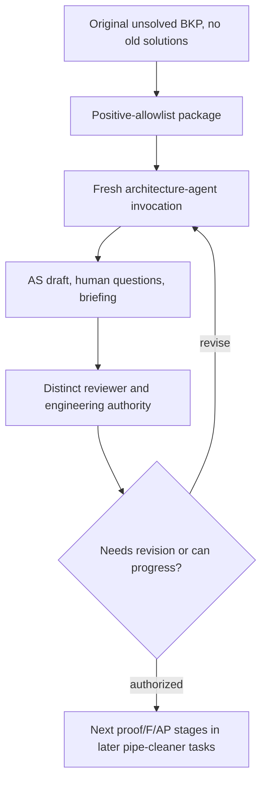

# CLN-TOY1-PIPE-CLEANER-001: fresh-start diagnostic

**Goal:** Execute the first substantive Archbot operation from the original
unsolved Toy 1 inputs, not rebuild its previous answer. **Status: prepared
source candidate, not locally run and not a formal cleanroom
qualification.** Human direction and bounded preparation scope are recorded
in `process/decisions/CLN-TOY1-PIPE-CLEANER-PREPARATION-001.yaml`.
Full cleanroom authority remains gated by FR-005/FR-006.

## Why we are running this now

A real engineering process must make progress when a fresh agent sees only
a problem. The next meaningful result is a new **draft** Architecture
Statement plus an honest list of uncertain source authority and missing
decisions. A fully reviewed AS from the previous Toy 1 run would defeat
the exercise. A large dual-project or Git-submodule migration would not
answer this question either. Those efforts are parked.

This is a diagnostic *pipe-cleaner*: do we get an intelligible first
artifact, traceable evidence, a sensible stopping point and useful human
questions? It is **not** the campaign's independently qualified
cleanroom replay, even if its local checks succeed.

## The starting boundary

The visible workspace contains exactly these previously inspected source
inputs, copied byte-for-byte at known Git blob identities:

- `knowledge/bkp/problem-origin.md`: original fictional engineering
  brief, including a latest-32 exact sum-of-squares request.
- `knowledge/bkp/adc.md`: synthetic unsigned 12-bit ADC model.
- `knowledge/bkp/target.md`: hypothetical 32-bit MCU with 2 KiB
  detector SRAM and no FPU.
- `agents/architecture-agent.md`,
  `agents/verification-agent.md`, and generic `REVIEW_AS.md`.
- the neutral project registry CLI and freshly generated empty
  project spine, project manifest, agent instructions and first task.

The original BKP's **1 ms timing language** is an important source
ambiguity. Later controlled Toy 1 decisions must **not** be included or
silently rewritten into the fresh brief. Whether 1 ms is a binding
stakeholder obligation, an assumed ADC cadence or an unsupported
demonstration detail must emerge from the fresh agent's provenance
analysis and subsequent human authority. Do not hand it the old answer.

Not included: prior Toy 1 `knowledge/architecture/AS-001/`, source
acceptance, proofs, AP/F, CON, DE, `implementation/toy1/`, VO/AD
decisions, review receipts, source-time history, tests containing worked
solutions, numbered pilot prompts, old `PROJECT_SPINE.md`, evaluator
oracle or `.git`. No prior conversation context or connected source may
be exposed through the agent's runtime.

The output is split:
```text
<external-output>/
├── workspace/              # Agent-visible only
│   ├── AGENTS.md
│   ├── TASK-001.md
│   ├── framework/          # Small problem-neutral subset
│   └── projects/CLN-001/   # New, unsolved project
│       ├── project.yaml
│       ├── PROJECT_SPINE.md
│       ├── knowledge/bkp/
│       └── out/            # Author writes only here for TASK-001
└── auditor_only/
    └── manifest.json       # Original source identities and copied-file hashes
```

The parent directory and auditor-only manifest must **not** be mounted
for the cleanroom author, and neither should the source repository
or host Git credentials/history. Directory packaging alone does not
enforce those runtime restrictions; verify them independently.

## Work to perform



Run these commands from the original Archbot checkout after pulling the
exact source candidate:

```bash
python -m unittest discover -s tests -p 'test_toy1_pipe_cleaner.py' -v
python -m unittest discover -s tests -p 'test_project_registry.py' -v

# Pick a new unique destination OUTSIDE the archbot repository.
output="$HOME/archbot-toy1-pipe-cleaner-001"
python tools/cleanroom_pipe_cleaner.py prepare --output "$output"
python tools/cleanroom_pipe_cleaner.py inspect --output "$output"

# Diagnostic smoke check for the clean, empty project manifest.
python "$output/workspace/framework/core/project_registry.py" \
  inspect CLN-001 --root "$output/workspace"
```

If `output` already exists, the builder refuses to overwrite it.
Use a fresh unique directory for a new trial. The tool never copies
the original project's `.git`; the output must be outside the source
checkout.

### Launch only a fresh agent

A new agent invocation should see **only** `workspace/`. Use a
separately configured workspace/container/VM/OS-user boundary or other
explicitly verified isolation. A simple `cd workspace` does not
prevent an unrestricted terminal tool from reading `../auditor_only/`
or your original checkout. This diagnostic may be run without formal
cleanroom qualification, but record any visibility gap and never call
it a qualified cleanroom.

Give the fresh architecture-agent only:

```text
Read AGENTS.md and TASK-001.md in this workspace.
Follow the architecture-agent role. Produce the permitted draft AS,
questions and briefing. Do not infer prior decisions or accepted status.
Stop after TASK-001.
```

A valid first result produces these three files within
`projects/CLN-001/out/`:

1. `AS-DRAFT-001.md`: Architecture Statement `AS=(C,R,PS)` with
   individual source links, assumptions and uncertainties.
2. `QUESTIONS-001.md`: explicit missing stakeholder authority and
   contradictions, including any uncertainty about timing.
3. `BRIEFING-001.md`: work performed, remaining obligations,
   limitations and the next review/approval gate.

This initial task should **not** jump directly to a ring buffer, a
selected architecture, old theorem `PR-002`, contracts or firmware.
If any such answer appears without derivation from the permitted
inputs, record contamination or unjustified inference for review.

After the task, rerun:

```bash
python tools/cleanroom_pipe_cleaner.py inspect --output "$output"
```

Any unexpected non-output file or changed input file is a failed
package integrity check. The result does **not** measure external host
or connector reachability.

## What to record for this first-run experiment

Keep a small, inspectable diagnostic note with: exact source and package
SHA-256 identity; exact fresh agent invocation/runtime; whether the
agent could reach old repo/.git, parent directory or connected context;
whether TASK-001 generated each artifact; whether outputs show original
BKP provenance; unanswered questions; any unauthorized commitment;
number of human interventions; actual errors; elapsed wall time if
measured. Never invent timings or failure counts.

Keep the evaluator's previously accepted solution and any hidden rubric
**out of the fresh agent's reach**. A distinct reviewer may compare
the draft against those references after submission, but should judge
obligation traceability and justified decisions rather than merely
matching the former implementation.

## After the first task

If this succeeds, authorize the next narrow stage
(`P/PO + F + AP`), followed by selected AP/CON, DE, C implementation,
and independent verification. Original Toy 1 product VO-002..VO-006
and final F-001 remain open until real evidence and authority.

The formal campaign order still includes FR-004 qualification of the
one required reviewer mode, FR-005 cleanroom packaging and independent
isolation review, and FR-006 integrated framework freeze. The pipe-cleaner
is **diagnostic**, not a stealth early execution of that formal gate.

No second project, Toy 1 submodule extraction, global path migration,
or previously solved artifact is needed to conduct this first trial.
