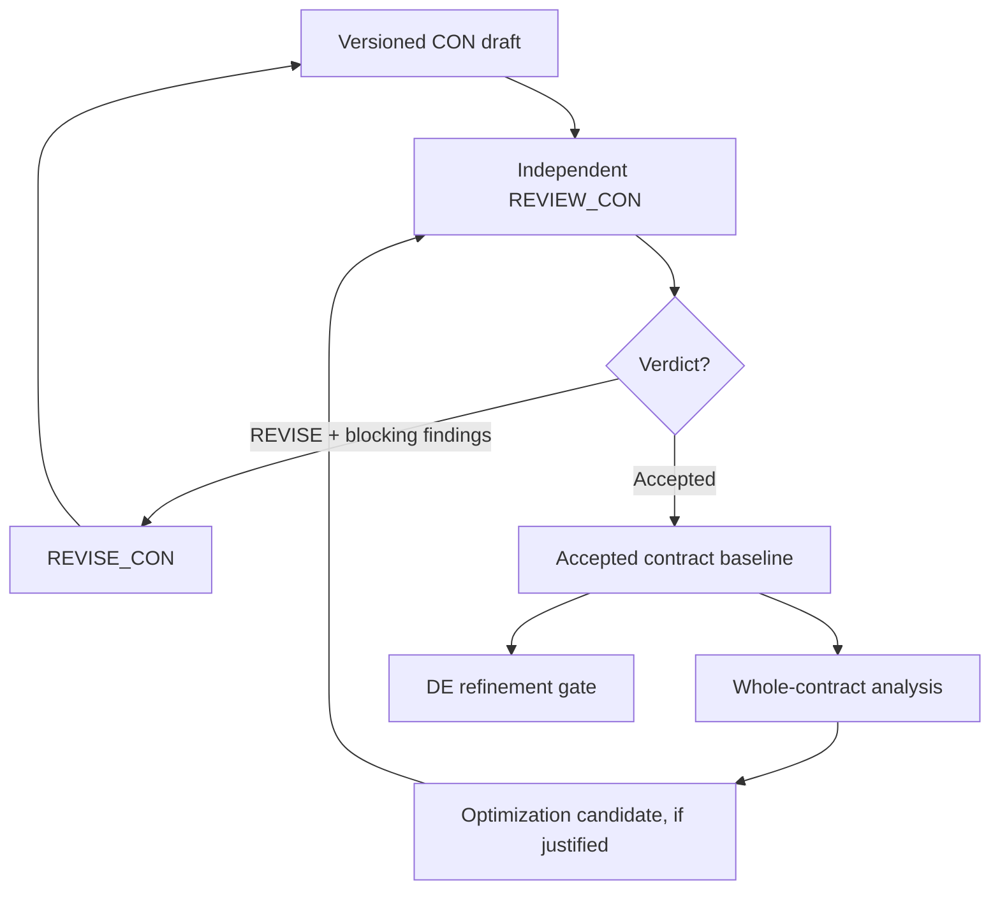

# Reusable contract iteration and optimization

**Status:** Manifest-planning slice committed; workstation tests and full two-toy qualification pending.

## Static process, changing data

The agent roles, playbooks, checks, and transition rules are reusable. Only
the triggering receipt, current spine, versioned contracts, and generated
task manifest change from iteration to iteration.



The existing `REVISE_CON` and `REVIEW_CON` playbooks remain unchanged.
`process/loop_transitions.yaml` defines the two recurring receipt
transitions. `tools/next_task.py` determines the next eligible operation
and emits a versioned task manifest. Its output does not constitute
contract approval or engineering authority.

## Supported commands

For a new independent review receipt:

```bash
python tools/next_task.py inspect \
  --receipt reviews/gates/TOY1-CON003-independent-review-v3.json
python tools/next_task.py emit \
  --receipt reviews/gates/TOY1-CON003-independent-review-v3.json
```

`inspect` prints the planned next step without writing files. `emit`
creates a manifest under `process/tasks/` unless a matching task already
exists. Both are local commands and require a pulled checkout.

To execute a generated task, take the `manifest_path` reported by
`emit` and run:

```bash
python tools/task.py inspect --manifest process/tasks/<generated>.yaml
python tools/task.py run --manifest process/tasks/<generated>.yaml
```

After the correction agent submits its new contracts and receipt,
invoke `next_task.py emit` with **that new submission receipt**.
The controller detects the newly authored Contract Spine concept
and generates the independent-review task. Repeat as needed.

Every round: inspect changes, run the test suite and structural checks,
commit and push. Neither command launches an unattended background worker.
Do not commit unreviewed raw log files or secrets.

## Eligibility and repeat safety

- An independent `REVISE` receipt with blocking findings selects `REVISE_CON`.
- A contract-authoring submission marked
  `CONTRACTS_READY_FOR_INDEPENDENT_REVIEW` selects `REVIEW_CON`.
- A malformed/nonindependent review does not trigger an iteration.
- Existing matching tasks are returned as `ALREADY_PLANNED`.
- The generated task ID is deterministic from its source receipt.
- Historical contract versions and review receipts stay versioned and
  immutable. Accepted proofs, AP authority, AS/F, and outstanding VOs
  are not changed by this planner.
- A positive independent review is **not** automatically converted
  into a DE-approval task. A separate accepted contract baseline and
  transition still need qualification.

## Avoid expanding requirements during iteration

A reviewer must distinguish a real obligation defect from a hypothetical
problem outside the approved AS. Preserve prior closed findings; reopen
only for changed evidence or a new counterexample.

A versioned ledger of findings should track:
`OPEN -> ADDRESSED_IN_DRAFT -> INDEPENDENTLY_ACCEPTED -> CLOSED`,
plus `UNRESOLVED` if the design lacks enough evidence.

## Whole-contract analysis before optimization

The user requested **analyze, then optimize**. After the contract baseline
is independently accepted:

1. Assemble the full interface graph and list all claimed externally
   observable guarantees, assumptions, fault modes, and allocations.
2. Compare the actual AS to each mechanism introduced during review.
3. Examine whether simpler protocols prove equivalent behavior or
   whether an integration precondition can replace unnecessary internal
   machinery without weakening the accepted semantics.
4. Evaluate symbolic `F_s`: state, instruction work, timing bounds,
   code size where supportable, verification cost and uncertainty.
5. Create an optimized contract candidate with an explicit refinement
   argument, then independently review it against the baseline.

The 32-bit sequence counter repeats after roughly 49.7 days at 1 kHz.
Modulo-counter aliasing deserves attention, including intentional data
loss, but an automatically expanded watchdog/loss-epoch design is not
necessarily the least-cost solution. Separate required semantics from
one particular implementation and preserve the C-002 memory ceiling.

The post-baseline analysis/optimization operations are **planned**, not
registered executable playbooks yet. Their outcome should become an
additional round of the same independent contract review, not an
unreviewed change to accepted architecture.

## Toy 2 qualification

Use the same controller and transition configuration with a different
architecture spine and receipt. Tests already construct distinct spines,
but a real second toy must confirm domain isolation and measure human
setup time, manual fixes and bespoke process edits before claiming
end-to-end genericity.
