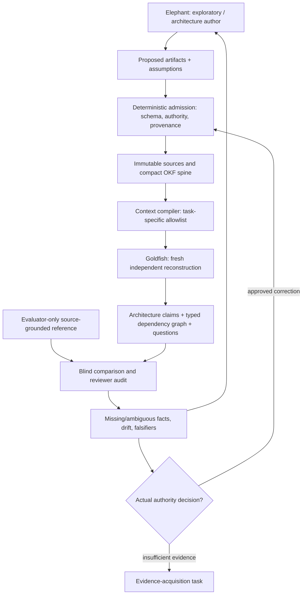

# EGM-001: Elephant–Goldfish architecture serialization experiment

**Status:** PROPOSED RESEARCH / BOUNDED DIAGNOSTIC, NOT ACCEPTED
GENERIC GATE OR FORMAL CLEANROOM QUALIFICATION.

**Origin:** [byte-preserved human research note](research/EGM_ELEPHANT_GOLDFISH_USER_NOTE_20261028.yaml),
`archbot_research_note` version `1.0`,
topic `elephant_goldfish_model_applicability`, `status: proposal`,
received 2026-10-28. The original uploaded source had SHA-256
`5f496b9da56e3de64c4466192cc272678870dcc30d2a6046b28cd917dacf4952`
(14,228 bytes). This document is a transformation of that source
into a test plan, not an independent confirmation of its claims.

## Why this belongs in Archbot

Archbot already treats the repository as canonical memory and uses
compact spines, OKF typed relationships, source-pinned reviews and
independent fresh agents. However, a fresh agent's existence does
**not** by itself test whether it can reconstruct the architectural
knowledge that an earlier long-context agent relied upon.

**Proposed acceptance criterion:** an isolated, fresh agent reconstructs
required claims, ownership, dependencies, proof assumptions and
interface boundaries from a compact spine plus permitted typed links,
without prior chats, unstated orchestration state or a hidden answer.
Another independent evaluator compares the reconstruction against
a separately curated, source-grounded canonical assessment rubric.

**Two different meanings of clean:** a clean repository source
projection and runtime-enforced tool/network/context isolation.
Creating a new directory demonstrates only the first at best.
Independence claims must state which were tested, not assumed.

## Roles and information boundaries

The Goldfish can traverse authorized links to source documents.
A deliberately tiny fixed input that omits necessary linked
documents tests context starvation, not architectural completeness.
The reviewer may have broader source access than the Goldfish,
but must not leak evaluator-only answers into the worker package.

Human-origin requirements, decisions, changed assumptions and late
artifacts are new attributable graph events. They can invalidate
a previous context projection and require a rerun, but must never
silently rewrite already completed input snapshots or prior review.

## Proposed process, keeping existing gates

| Phase | Input / responsibility | Boundary-specific output |
| --- | --- | --- |
| E1 Elephant exploration | source BKP and selectively traversed existing spines | proposals, explicit questions and assumptions |
| E2 deterministic serialization | reviewed/authorized changes only | versioned spine links, contracts, proof/ERS records, source hashes |
| E3 fresh Goldfish reconstruction | spine and *only permitted* linked sources | independent normalized claims, relations, unknowns, questions |
| E4 resolution | source-linked findings, responsible engineering authority | new versioned resolutions or explicitly rejected findings |
| E5 proof checks | exact hypotheses and accepted proof authority | architectural invariants / falsifiers, not automatically firmware qualification |
| E6 cleanroom-style implementation | eligible accepted sources and checked context | **S0 linkable skeleton first**, with map/symbol/size evidence |
| E7 postimplementation Goldfish | implementation + accepted sources, no previous worker conversation | drift / undocumented specialization findings |
| E8 canonical refresh | reviewed changes and recorded decisions | updated spine projection, never rewritten original evidence |

No phase bypasses the existing AS/P/F/AP/CON/DE/ERS/verification
authority. A Goldfish review is an **assessment**, not a binding
engineering decision, and does not imply formal FR-005 cleanroom
qualification or permission to select an AP.

## EGM-INV proposed constraints

- **EGM-INV-1:** No fact required for correct implementation is allowed to
  live *only* in agent conversation. Goldfish must recover its source
  or explicitly report it missing.
- **EGM-INV-2:** Every architecture-changing specialization must cite
  a contract, scoped proof, generated precondition or authorized source.
  A bare "optimizer selected this" is insufficient.
- **EGM-INV-3:** When a Goldfish fails to reconstruct a dependency,
  record a *candidate specification defect*. Independently distinguish
  absent source, broken link, truncated projection, task ambiguity,
  tool failure and Goldfish reasoning error before disposition.

These are proposed process rules, not activated general gates.

## The first bounded, offline experiment (EGM-P0)

**Goal:** test the serialization protocol on a tiny independently
invented, non-Toy1 fixture, then apply it without leaking any old
Toy1 solved AP/CON/DE/C. A separate project can later enter from
existing C code or proof, not necessarily from AS.

1. The author creates immutable project artifacts and an OKF-like
   spine with typed links. All acceptance/authority flags are explicit.
2. The evaluator prepares a **private** expected claims-and-edges
   rubric, grounded in the same readable source set. It never
   appears in the Goldfish context.
3. A deterministic compiler builds a positive allowlist from the
   spine and checks source identities and allowed traversal paths.
   Only this compiled projection is supplied to a fresh Goldfish.
4. The Goldfish reconstructs a machine-readable model with stable
   fact IDs, typed relationships, source citations, explicit
   `UNKNOWN` entries and questions. It must not invent a provider,
   requirement or approval.
5. A deterministic structural checker compares required fact IDs,
   typed edges and source-reference membership to the private
   rubric, reporting missing/extra assertions and incomplete proof
   references. A **separate reviewer** judges semantic equivalence,
   correctness of the canonical rubric and suspected agent errors.
6. For an implementation gate, Goldfish creates an **S0 complete
   linkable skeleton** rather than behavior first. Compare public
   symbols, declared module dependency graph, ABI and init order
   to the accepted source; retain link map and runtime/stack
   limitations. Link success is not functional verification.
7. After independently reviewed changes, rerun from a fresh agent
   and measure whether ambiguities and required human prompts drop.
   Do not train the new worker on old answers during the run.

The companion tool `experiments/egm_serialization/assess.py`
is a **structural comparator only**. It cannot score semantic
equivalence, infer source authority, authenticate a clean sandbox
or pronounce accepted proofs. The evaluator-only reference must
be kept outside the Goldfish's permitted context.

## Failure taxonomy and disposition

- `MISSING_SOURCE`: required fact has no authoritative artifact.
- `BROKEN_RELATION`: fact exists but necessary typed edge is absent.
- `MISSING_PROOF_SCOPE`: implementation-critical invariant lacks
  its exact applicable hypothesis/accepted authority.
- `CONTEXT_PROJECTION_OMISSION`: source exists but context compiler
  omitted an authorized path.
- `HIDDEN_CONVERSATIONAL_DEPENDENCY`: cannot reconstruct without
  Elephant conversation; separate from arbitrary reasoning failure.
- `GOLDFISH_ERROR`: all material sources are accessible, yet the
  fresh model misreads or drops a claim.
- `UNSUPPORTED_ASSERTION`: Goldfish invents an approved provider,
  algorithm or constraint not licensed by its source graph.
- `DRIFT`: changed code, proof or source is not reflected in the
  serialized active applicability/provenance graph.

Each finding needs exact source hashes, traversal evidence, role
identities, counterexample, proposed owner and a concrete next action.
The orchestrator must route missing information to **evidence
acquisition**, not arbitrarily repeat the same review.

## Metrics and stop conditions

Measure `goldfish_questions_count`, `missing_link_count`,
`undocumented_assumption_count`, source traversal depth and
token count, time to first **linkable** skeleton, code rework,
proof failures discovered before code, postimplementation drift,
elapsed eligibility-to-reviewed-decision and human active minutes.

Track these as separate measures: exact fact/edge coverage,
unsupported asserted facts, semantic reviewer findings, source
access/independence, engineering evidence actually produced.
Do not conflate a structural 100% match with full correctness.

**Block / stop:** missing authoritative source; unavailable required
provider; contaminated reviewer inputs; failed current source pins;
unresolved protected requirement or unapproved binding decision;
replay cannot independently recover source. An unverifiable
isolation claim stays `UNKNOWN`, not `PASS`.

**Next authorization:** review the offline EGM-P0 scope and code
before making Goldfish a mandatory gate or launching any
independent online/agent worker. The current CLN-001 Stage-12
review remains the formal next diagnostic gate. Do not reboot
Toy1, activate a new cleanroom or merge experimental APs merely
because this proposal is in the roadmap.

## Related Archbot artifacts

- [Current program roadmap](../process/roadmaps/PC_ROADMAP_CURRENT.yaml)
- [EGM research plan](../process/roadmaps/EGM_GOLDFISH_001.yaml)
- [CLN-001 progress/orchestrator companion](../process/roadmaps/CLN001_PROGRESS_AND_HARNESS_001.yaml)
- [Offline harness architecture proposal](ARCHBOT_HARNESS_ARCHITECTURE_001.md)
- [Skeleton-first implementation protocol](IMPLEMENTATION_SKELETON_FIRST_001.md)
- [Process Orchestrator and Human Attention proposal](PROCESS_ORCHESTRATOR_HUMAN_ATTENTION_PROPOSAL.md)
