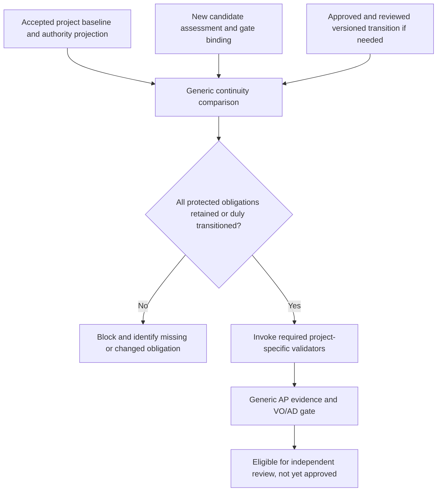

# FR-002: project-owned accepted-baseline continuity replacement

**Status:** Proposal only. Source changes are not yet approved, written or tested.
**Scope:** [Machine-readable bounded proposal](../process/proposals/FR002_BASELINE_CONTINUITY_REPLACEMENT_001.yaml).
**Operating contract:** [Cooperative engineering audience](../process/decisions/PC-COOPERATIVE-AUDIENCE-001.yaml).

## 1. The engineering problem

The original FR-002 gate refactor usefully separated reusable AP checks (`tools/gates/common.py`) from Toy 1's C-002 charged-SRAM validator (`tools/gates/toy1_c002.py`). Its first independent review returned **REVISE**: a candidate policy could remove C-002, compute fresh content hashes and omit the required validator. The R1 correction instead hardcoded Toy 1-specific authority file identities in the shared engine (`tools/gates/authority_roots.py`). R1 has a local regression receipt, but **not an independent acceptance**. Its hostile-forgery-oriented reviewer task is paused, not approved.

We now assume friendly developers and agents following the engineering protocol. They can make mistakes. We must prevent **unintentional changes to accepted obligations**, not guarantee resistance to deliberate source/review forgery. We also require the same generic engine to work on Toy 2 without changing a compiled-in project trust registry.

## 2. Replacement architecture



The *accepted project baseline projection* and the *proposed candidate* are separate inputs, not one self-referencing candidate document. The operator selects the accepted baseline from the project's documented, reviewed authority. The generic engine checks continuity against that selected baseline and records its source revision. Content hashes establish byte identity; they are not signatures and do not independently confer stakeholder approval.

An obligation `r` from the accepted baseline must satisfy:

```text
Retained(r) OR ApprovedAndReviewedTransition(r)
```

An absent validator or changed protected decision without either must block with a precise diagnostic. Legitimate engineering changes are allowed when they carry their own versioned decision, review and effective baseline transition. This prevents permanent hardcoding of obsolete requirements.

## 3. Candidate project-owned input

Illustrative schema, **not yet approved or installed**:

```yaml
schema: pc-project-ap-continuity/v1
project_id: AS-001
project_spine: /architecture/AS-001/spine.md
accepted_baseline: process/baselines/AS-001-v2-active.yaml
baseline_review: reviews/gates/TOY1-BASELINE002-independent-review.json
policy: process/policies/AP_SELECTION_v2.yaml
active_vo_ledger: process/ledgers/vo_ledger-AS-001-v2-active.yaml
ad_ledger: process/ledgers/ad_ledger.yaml
protected_scope_decisions:
  C-002: process/decisions/C-002-scope.yaml
required_validators:
  C-002:
    implementation: tools/gates/toy1_c002.py
    id: TOY1_C002_CHARGED_SRAM
accepted_authority:
  provisional_ap: process/decisions/AP-002-AS-V2-RECONFIRMATION-001.yaml
transition: null
```

The Toy 1 projection must be **derived additively** from accepted evidence, reviewed for faithful correspondence, then used as the project's accepted comparison reference. Do not modify the approved AS, AP, F, C-002 scope, VO/AD ledgers or historical receipts just to populate the new schema.

## 4. What to keep and change

| Keep | Replace or add |
|---|---|
| `tools/gates/common.py` AP eligibility mechanics | A generic continuity comparator, proposed as `tools/gates/continuity.py` |
| `tools/gates/toy1_c002.py` project-specific SRAM checks | A project-owned baseline authority projection and candidate gate-binding v2 |
| Exact role, VO/AD, AP-due and negative decision rules | `tools/gates/binding.py` no longer calls `trusted_root(project_id)` |
| Explicit generic `--binding` and opt-in historical `--legacy-toy1` | The live engine dependency on `tools/gates/authority_roots.py`; retain Git history |
| Original evidence and review receipts | New scoped source and test receipts, then an independent review |

Do not broaden this work to `tools/pc.py`, reviewer launch qualification, FR-003 historical auditor, cleanroom input package or product firmware.

## 5. Acceptance and regression matrix

| Case | Expected behavior |
|---|---|
| Approved Toy 1 C-002 | Preserve 2048-byte detector-attributable SRAM limit, all seven charged categories, positive margin and all earlier negative gate tests |
| Candidate omits C-002 requirement or validator | Block and name accepted baseline obligation, even if the candidate document is internally consistent |
| Wrong baseline, missing ledger, stale policy or scope decision | Explicit reconciliation failure; never substitute AS-001 defaults for another project |
| Synthetic versioned, reviewed and approved transition | Permit intentional replacement of a **synthetic** protected requirement after checks; no real Toy 1 constraint is relaxed |
| ROOT-002 synthetic solver | Same generic machinery works with a different project-owned projection and no engine source allowlist change |
| Candidate asserts it was approved by itself | Remain pending review/authority, never advance based solely on self-description |
| Gate returns eligible | Do not claim AP selection, C/firmware correctness, target qualification, final F result or VO discharge |
| Old FR-002 reviews and R1 evidence | Remain unchanged and retrievable by historical revision |

## 6. Phased implementation, only after separate authorization

1. Create the new project-owned Toy 1 authority projection from accepted files and preserve source links; keep it a candidate until reviewed.
2. Refactor only the bounded generic binding and continuity code. Preserve existing Toy 1 validator semantics and programmatic compatibility.
3. Implement positive, omission, mismatch and legitimate-transition tests. The synthetic ROOT-002 model is structural simulation, not a new approved project.
4. Human pulls, runs tests and retains logs; only successful bounded evidence receipts are published.
5. A *different independent reviewer* challenges baseline continuity and authorized transitions under the cooperative assumption. The old R1 review task remains paused as history.
6. An acceptable scoped review could close FR-002. FR-003 requires its own subsequent authorization.

**Authority limits:** The proposal does not authorize source edits, framework freeze, cleanroom, target selection, F-001 completion, VO discharge or AD modification. FR-001's earlier acceptance remains limited to role-projected context.
