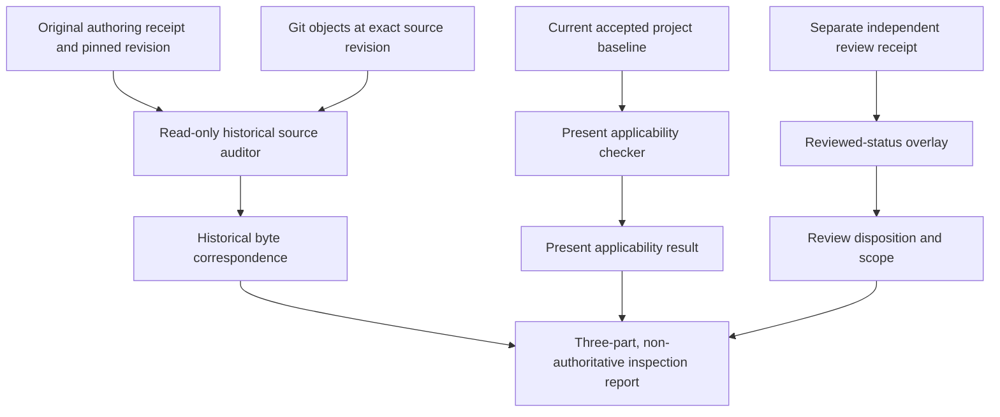

# FR-003: source-time historical evidence integrity

**State:** proposal for a bounded read-only auditor, not source authorization.  
**Proposal:** [FR003-HISTORICAL-INTEGRITY-001](../process/proposals/FR003_HISTORICAL_INTEGRITY_001.yaml).  
**Predecessor:** FR-002 cooperative baseline-continuity implementation was independently `ACCEPT_WITH_CLARIFICATIONS` at `2dbd7b003ed515b916595287b8d29478fc1aa805`. This result does not authorize FR-003 code.  
**Operating assumption:** cooperative people and agents, including accidental errors or stale inputs; no hostile Git forgery requirement.

## 1. Source-backed gap

`tools/verification_kernel.py:check_pins` hashes the current worktree for every item in `source_sha256`. That is the right check when preparing or running a **new** verification task. It is not a historical audit: if a reviewed source was later updated, `check_pins` rejects today's bytes, even when the exact historical bytes originally used by a receipt are still available in Git.

`tools/active_baseline.py:verify` similarly asks whether a particular active baseline and its current reviewed sources remain coherent **now**. It should continue to do so. Existing independent-review route tests already resolve old files using `git show <full-commit>:<relative-path>`; FR-003 makes a narrow reusable auditor out of that pattern, rather than modifying past review artifacts.

Do not collapse **historical identity**, **present applicability**, and **independent review disposition** into one boolean.

## 2. Three independent answers

| Question | Input | Result and scope |
|---|---|---|
| **H: Was this source exactly what the historical receipt identified?** | Full 40-character Git revision, historical paths and source digests, optional original receipt identity | `HISTORICAL_MATCH`, `HISTORICAL_MISMATCH`, or `UNRESOLVED`; byte correspondence only |
| **A: Is that evidence applicable to the currently selected project baseline?** | Current accepted baseline/policy, applicable scope and current sources | Separate current-status report, no overwrite of H |
| **R: What independent decision was made about it?** | Separate review receipt, reviewed subject/scope and original authoring record | Historical author's `PENDING` stays historical; review disposition remains a distinct linked record |

For a source-time file (b_{r,p}), the historical predicate is:

\[
H(r,p,h)=\big[\operatorname{SHA256}(b_{r,p})=h\big].
\]

Here `r` is a **specific immutable commit ID**, `p` a path *within that tree*, and `h` the digest that was recorded. This predicate says nothing about current validity, semantic proof, independence, stakeholder approval, or product acceptance.

## 3. Minimal proposed architecture



The initial FR-003 implementation should provide the H lane and a **read-only optional current correspondence column**. The A lane may delegate to existing project-applicability checks; do not invent a universal current-applicability decision. The R lane may report an explicitly linked independent review receipt without changing its disposition. Do **not** build a new accepted-status database or auto-update an old `review_state` field in this task.

### Candidate CLI and API

```text
python tools/historical_audit.py inspect \
  --receipt reviews/qualification/FR002_BASELINE_CONTINUITY-local-test-receipt.json \
  --revision 44063ef971bcfd13e96c29eb5371e8fcc14e333a
```

Exact arguments and schema are implementation candidates, not installed commands. For receipts that have a `source_revision`, the tool should verify the requested revision matches it. A receipt without enough source-time information should yield `UNRESOLVED` and identify the missing field, not guess `HEAD`.

Suggested machine-readable result (schematic):

```yaml
schema: pc-historical-source-audit/v1
historical_status: HISTORICAL_MATCH
source_revision: <full_git_commit>
evidence_class: SOURCE_BYTE_CORRESPONDENCE_ONLY
items:
  - path: process/example.txt
    expected_sha256: <declared_64_hex>
    historical_sha256: <actual_64_hex>
    result: MATCH
current_correspondence: NOT_CHECKED
review_overlay: NOT_CHECKED
product_verified: false
authority_changed: false
```

Use one canonical output for reproducibility. Missing Git objects or unsupported input shapes are explicit `UNRESOLVED`, not an assertion of historical mismatch.

## 4. Bounded implementation boundaries

The auditor is **read-only** and uses explicit revision/path values, not branch names or `HEAD`. A valid source identity includes a 40-hex Git commit SHA and a repository-relative normalized path; reject path traversal, empty paths, unsafe revision expressions and symlink-based ambiguity. Read Git blobs through a bounded, argument-list subprocess call or a narrowly defined Git adapter; no shell command interpolation, network fetch, executing archived contents or modifying `.git`. Use the existing 2 MB per-file reader bound as a starting point and document any exceptions.

Preserve `verification_kernel.check_pins` for current task freshness and `active_baseline.verify` for its present acceptance guard. History must be verifiable against the original source revision, **not today's worktree digest**.

Not all historical receipt schemas have identical source-revision or hash keys. The first implementation should document and test explicitly supported shapes, including `source_sha256` and `source_git_blob_sha1` where present, and return `UNRESOLVED` for unsupported evidence rather than guessing a mapping. Do not import every historical file or generalize through unreviewed heuristics.

## 5. Concrete evidence canaries

1. Commit a synthetic source and receipt; later change the source in a descendant commit. H remains `HISTORICAL_MATCH`; current byte correspondence becomes `DIFFERENT`. The old receipt remains untouched.
2. Use a false source-time digest at the original commit. H becomes `HISTORICAL_MISMATCH`, even if a current file happens to match the false digest.
3. Missing source revision, unavailable commit, inaccessible historical object, missing required digest, or unsupported schema yields `UNRESOLVED` with a concrete reason.
4. Reject ambiguous refs such as `main`, `HEAD`, path traversal and revision/path metacharacters. Never accept arbitrary shell syntax.
5. Verify both SHA-256 and Git blob SHA-1 when both are provided. Do not mistakenly compare Git blob SHA-1 to a raw-byte SHA-1.
6. Retain the original verification artifact's `review_state=PENDING` while displaying a separately linked independent reviewer disposition, including prior `REVISE` cases.
7. A newer active baseline can supersede an old one without erasing the earlier source-time review.
8. Exercise synthetic non-Toy-1 project paths; no `AS-001` or C-002 defaults.
9. Existing VK-001, FR-001/FR-002 history-route and active baseline regressions continue to pass.
10. Independently review the auditor's claimed scope, actual test results, source provenance and read-only behavior.

## 6. Authority and next step

The next eligible action is to obtain explicit engineering approval for the bounded source paths listed in the machine-readable proposal. After approval, commit the source candidate, have the human run and push local regression evidence, and commission a distinct independent reviewer. A passing audit does **not** upgrade a `PENDING` artifact, accept a VO, declare an active baseline, approve firmware, prove target behavior, freeze the framework or authorize cleanroom.

No accepted Toy 1 files, active VO/AD ledgers, review receipts or historical authoring records are to be rewritten. FR-004 (reviewer execution), FR-005 (cleanroom package) and FR-006 (integrated freeze) remain separate milestones.
