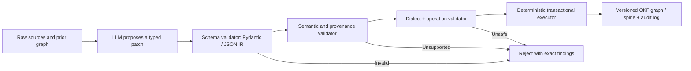

# Goblin Graph reuse candidate: deterministic portable BKP spine builder

**Status:** PARKED DESIGN NOTE; NOT IMPLEMENTED, APPROVED OR AUDITED.
**Purpose:** Preserve a cross-project reuse opportunity without interrupting
CLN-001 Toy 1 AP independent review or its downstream qualification.
**Origin:** Human recalls earlier work named *goblin-graph*. Prior
project discussions describe a Kuzu graph-backed memory/reasoning
substrate with typed/versioned nodes and edges, CCNs, weighted
selective traversal, and structured LLM patch proposals. The
goblin-graph source is **not currently mounted as a connected Git
repository**, so no present implementation, API, tests or code
reusability are claimed by this note.

## Core architectural reuse

The prior Goblin Graph design already made the useful split:



The LLM does **not** directly write authoritative spine files.
It proposes a *change set*. Only an approved deterministic
executor modifies typed graph state or materializes OKF Markdown.
Both an accepted patch and its rejected alternatives remain
provenance-linked events as warranted.

Relevant Goblin Graph concepts to evaluate for reuse (derived
from prior discussions, **not yet source-audited here**):
- `PatchAttempt` / `PatchDecision` and immutable change/provenance
  history, with a Pydantic/JSON patch intermediate representation;
- semantic rules in addition to structural validation (schema-valid
  content can still be meaningless or unsupported);
- Kuzu dialect validation and deterministic application, distinct
  from LLM-generated Cypher execution;
- typed knowledge nodes/relations, CCNs, A*-like/weighted retrieval,
  selective context compilation and graph module boundaries;
- ingestion architecture separating original raw artifacts,
  extracted typed claims/events, and evidence/situation history;
- modular knowledge with reversible merge/unmerge and source identity.

**Do not transplant** the storage backend, retrieval weights or
Kuzu-specific executor merely because the earlier project used them.
A portable Archbot OKF builder could use Git/YAML/Markdown and
canonical JSON as an interchange format, with Kuzu as an optional
index/query adapter after compatibility review.

## Intended reusable inputs

1. **Sensor datasheet PDF module.** Preserve the original PDF
   version and SHA-256; obtain source-addressable page/section/table
   fragments; propose typed claims for register maps, electrical
   ranges, timing, modes and operating preconditions. Every
   extracted claim needs a precise source span. Distinguish
   typical values from guaranteed min/max, and separate
   revision-specific errata. Never infer unsupported register
   values or override a datasheet's qualification wording.
2. **Spanish Magic Castle or NAIA theorem module.** Preserve exact
   proposition, quantifiers, assumptions, proof/review disposition,
   counterexamples, source revision and dependencies. A theorem
   summary is a navigation object, NOT the theorem's proof or a
   transfer of its authority to a new domain. Applicability must
   be rechecked against the consuming project's AS/plant model
   and source versions.
3. **Arbitrary reusable engineering knowledge module.** Distinguish
   background context, hypothesis, empirical observation,
   accepted mathematical result, interpretation and requirement.
   A reusable component cannot silently become a project's
   accepted requirement merely by import.

The spine indexes claims and linked evidence. Large raw PDFs,
datasets, calculations and proofs remain in separate retrievable
artifacts. Context projection uses typed edges and mandatory
dependency closure, not destructive compression.

## Necessary safety layers

**Structural validation:**
- stable IDs, allowed node/edge kinds, required field types,
  referential integrity, no dangling links or malformed frontmatter;
- deterministic serialization/ordering, repeatable IDs and
  idempotent application; no unchecked free-form graph statements;
- enforce source module and destination namespace boundaries.

**Semantic validation:**
- accepted predicate/edge combinations and lifecycle states;
- a `proven_by` edge only to an actual accepted proof with matching
  assumptions and scope, never to a proposed proof opportunity;
- controlled `supersedes` vs `contradicts` vs `derived_from`,
  with bidirectional trace where meaningful;
- no automatic promotions from extraction or an LLM confidence
  number to engineering authority;
- detect conflicting units, incompatible conditions, revision
  mismatch and broken dependency closure.
- confirm each claim's source reference resolves to its exact
  imported source bytes/spans, or mark it UNVERIFIED.

**Epistemic validation:** structural and semantic consistency do
**not** prove factual truth. Source snippets can be misread,
tables OCR'd incorrectly, a datasheet revised, a theorem
misapplied, or a valid-looking statement hallucinated. Unsupported
claims must be rejected or retained only as explicitly unverified
proposals. High-consequence extracted claims may need independent
source comparison or human sign-off before their adoption.

**Deterministic application:**
- candidate patch from the LLM is stored, not applied directly;
- read-only dry run and detailed diff/impact report before mutation;
- exact base version and optimistic concurrency check before
  transaction; no rewrite of immutable source records;
- only executor writes canonical frontmatter/relations;
- append `PatchDecision` with accepted/rejected reasons,
  affected identifiers, before/after hashes and source provenance;
- make retries idempotent and allow source-module rollback by
  versioned state transitions rather than erasing prior evidence.

## Portability and consumption

Potential stable interchange, independent of Kuzu:
```text
module/
  manifest.yaml          # identity, version, source digests, namespaces
  spine.md               # generated Markdown/YAML navigation only
  claims/                # typed, source-grounded claims
  relations.jsonl        # typed edges and authority status
  raw/                   # original files/references, no destructive pruning
  provenance/            # patch attempts, decisions, source spans, revisions
```

**Illustrative only**, not a frozen schema. A project may import
a pinned module as BKP evidence and reference it using typed edges.
It may not silently inherit product-requirement status, physical
applicability or proof acceptance. Version updates must provide an
impact list to consumers; a project can keep the old pin until
reviewed.

## Proposed evaluation plan, after current CLN-001 work

1. **Source audit of actual Goblin Graph repository.** Identify
   executable patch IR, Pydantic models, semantic rules, executor,
   module export and their tests. Compare source revisions to this
   historical design note. Mark unsupported assumptions explicitly.
2. **Tiny deterministic pilot:** one short sensor PDF with a
   register table, a typical/guaranteed specification distinction
   and a contradictory erratum. Import original source spans.
   Require that malformed edges, bad units, unsupported values,
   revision ambiguity and false promotion be rejected.
3. **Theorem knowledge pilot:** three small synthetic propositions
   with reviewed/unreviewed statuses and a broken assumption
   dependency. Prove no `proven_by` authority leaks to a consumer
   and that dependency closure survives small context projections.
4. **Export, import, update and unmerge:** validate stable IDs,
   full provenance, bounded context selection, deterministic
   diffs, idempotent replay and cross-project pinning.
5. **Independent review and human usability:** test that a human
   can jump from a summary to actual datasheet pages or theorem
   assumptions and challenge it before adopting consequential
   claims.

Track context byte savings but do **not** optimize only for
compression ratio. A spine that drops a theorem's hypotheses
or a datasheet's operating conditions is a dangerous success
on the wrong metric.

## Separation from current Archbot activity

- **Not a new Archbot authority:** this is a parked proposal,
  not acceptance, and cannot amend BKP/AS/F/AP/ERS or VO state.
- **No new execution:** no PDF was parsed, code audited, test run,
  connector installed or Git data imported from Goblin Graph.
- **No detour:** CLN-001's Stage-6 competing AP candidates are
  archived but still await distinct independent AP review.
- **Integration candidate:** once scoped, a spine builder would
  provide source-grounded BKP modules to the Process Orchestrator;
  the Orchestrator handles task transition, review and human
  briefings, not source-claim mutation authority.

**Next action on this branch remains the independent CLN-001 AP review.**
