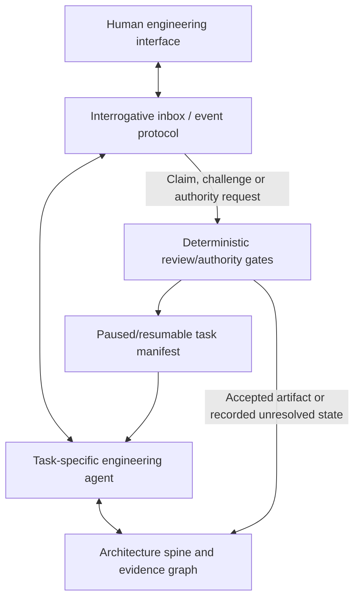

# Bidirectional human-agent interrogation

**Status:** Deferred design proposal, **not implemented**.  
**Intended qualification:** After Toy 1 end-to-end and Toy 2 retargeting trials.  
**Scope:** All Progressive Concretization architecture, proof, contract, design, and implementation stages.

## Purpose

A human should be able to ask, challenge, explain a preference, inspect
evidence, or request a what-if analysis at **any time**. Agents should also
be able to request missing facts or protected decisions from the human
when those materially affect the next valid concretization step.

This is **not** an always-open chat bolted onto Codex. It is a
versioned, typed, bidirectional **inquiry protocol** with durable
context and controlled promotion of answers into knowledge.

> A question is an artifact. An answer is information or a proposed
> decision. Only an applicable authority and verification process can
> promote it into a binding engineering claim.

## Conceptual architecture



No application must present this as a functioning real-time REPL until an
actual runtime and tests exist. The first implementation should work with
**durable inquiries and discrete resumes**. Live interruption can be added
as an adapter without changing the protocol.

## Directions and inquiry kinds

### Human → agent

- **WHY:** Explain a conclusion via a reviewable evidence chain, assumptions,
  constraints, and alternatives. Do not expose private reasoning traces.
- **TRACE:** Show the relevant path from implementation/CON/AP back to AS/BKP,
  with sources and acceptance status.
- **WHAT_IF:** Explore an altered constraint or premise in a detached
  hypothetical view. Never mutate accepted artifacts from exploration alone.
- **CHALLENGE:** Register a possible counterexample, objection, or new
  source of evidence; route it to independent review where applicable.
- **PROPOSE:** Offer a requirement, design alternative, fact, or experiment.
- **AUTHORIZE:** Explicitly approve or reject a *specified, versioned*
  protected decision. Ordinary conversation must not imply approval.

### Agent → human

- **CLARIFICATION:** A genuine ambiguity makes the current obligation
  underdetermined.
- **EVIDENCE_REQUEST:** Human can provide missing physical/source evidence,
  but a response is not independent verification.
- **CAPABILITY_QUERY:** Establish whether the integration can meet an
  interface precondition, e.g. producer metadata or scheduler behavior.
- **TRADEOFF_REQUEST:** Present options, affected F_s/F_f objectives,
  downside risks, fallback, and explicit authority scope.
- **AUTHORITY_REQUEST:** Seek a protected approval with an exact decision
  record and conditions.
- **COUNTEREXAMPLE_REVIEW:** Explain an inconsistency and solicit new
  facts or corrected premises before updating the underlying BKP.

Agent-generated requests should include why the information matters,
what happens under each plausible answer, and what work can proceed
without the answer. An agent should **not** ask a human for information
that can be cheaply and safely recovered from the existing BKP.

## Proposed inquiry object

An inquiry is **not** equivalent to a free-form chat transcript. A minimal
serialized record could be:

```yaml
schema: pc-inquiry/v1
id: INQ-EXAMPLE-001
status: OPEN
direction: AGENT_TO_HUMAN
kind: CAPABILITY_QUERY
origin:
  task_id: TASK-EXAMPLE
  role: contract-agent
  git_revision: example-source-revision
subject:
  spine: /architecture/example/spine.md
  artifact: /architecture/example/contracts/CON-EXAMPLE.md
  clause: CON-EXAMPLE-INPUT-CONTINUITY
question: Can the producer expose acquisition-order sequence information?
why_needed: >-
  A silent dropped sample is observationally indistinguishable from
  a correct contiguous stream without additional metadata or a
  separately enforced delivery guarantee.
choices:
  - sequence_assigned_at_acquisition
  - independently_verified_lossless_transport
  - neither_available
  - unknown
impact:
  blocked_gate: CONTRACT_REVIEW
  affected_obligations: [R-EXAMPLE-CONTINUITY]
  safe_to_continue: [unrelated_proof_opportunity_review]
response:
  status: PENDING
  respondent: null
  text: null
  cited_evidence: []
resolution:
  classification: UNRESOLVED
  accepted_artifact: null
  authority_receipt: null
```

Identifiers and paths above are illustrative, not established OKF or
archbot runtime fields. A simple Markdown inquiry concept with YAML
frontmatter could reference this record through a typed spine edge.

## Inquiry state and gate interaction

The inquiry has its own lifecycle:

```text
OPEN -> HUMAN_RESPONDED -> INTERPRETED -> {EVIDENCE_PENDING,
                                           DECISION_PENDING,
                                           RESOLVED,
                                           REJECTED}
       -> CANCELLED_WITH_REASON
```

A **task** independently has `RUNNING`, `BLOCKED_ON_INQUIRY`,
`ELIGIBLE_TO_RESUME`, and terminal gate outcomes. These should not be
confused with the inquiry's own state.

Important distinctions:

1. A human answer may be a **claim**, **preference**, **assumption**,
   **new evidence**, or **explicit authority action**. Record its type.
2. A human assertion about physical capabilities cannot be treated as
   measured evidence. Attach a verification method and due stage.
3. A binding approval requires an exact proposal reference, approved
   scope, respondent authority, and durable acceptance receipt. A short
   casual "yes" without a referent cannot authorize an unrelated gate.
4. When information is missing, only the **dependent gate** pauses. Other
   independent work may proceed against the current accepted knowledge.
5. On response, load the task manifest and impacted evidence. Resume from
   a durable checkpoint rather than requiring the previous LLM conversation
   context to remain available.
6. Preserve original questions and answers; corrections create versions
   instead of editing history invisibly.

## Example: loss-of-continuity in Toy 1

The independent contract review identified that arbitrary input values do
not reveal whether one acquisition sample was silently lost. The agent
asks whether sequence identifiers are assigned **before** possible
transport loss, or whether the producer has a separately justified
lossless-delivery guarantee.

A human may reply:

- "The ADC mock produces a monotonic acquisition counter." This
  becomes an **unverified integration capability claim** until the
  interface/source and correct placement of the counter are established.
- "I cannot provide either guarantee." The relevant contract must stop
  claiming universal continuity detection; investigate new signaling,
  change the approved requirement through authority, or report the
  impossibility under available observations.
- "Why is this necessary?" The agent returns the two-history
  indistinguishability counterexample and the affected requirement.
  It should not silently select an alternative on the human's behalf.

A sequence counter assigned **after** a sample is lost does not establish
that the acquisition itself was contiguous.

## CLI and UI (future adapters only)

The same protocol could support a terminal REPL, a web interface or a
Codex-side inbox. Illustrative, **not-yet-implemented** commands:

```text
pc inquiry inbox --spine /architecture/example/spine.md
pc inquiry ask --task TASK-ID --kind WHY
pc inquiry respond INQ-ID --choice sequence_assigned_at_acquisition
pc inquiry challenge INQ-ID --evidence path/to/source
pc task resume --inquiry INQ-ID
```

Do not present these as runnable commands before implementing them.
The simplest initial adapter is a local command that prints pending
questions, persists a human answer, and launches a fresh agent task
using the updated graph. Live REPL conversation is a later interface,
not a prerequisite.

## Interaction economy and safety

- Ask only if the expected decision value exceeds interruption cost.
- Batch nonblocking questions; isolate any gate-blocking question.
- Deduplicate equivalent questions across agents and spines.
- Show the user the **minimum necessary evidence** and provenance, not
  giant datasets or internal model trace dumps.
- Distinguish answers meant to be private or local from user-approved
  source artifacts committed to Git. Avoid storing secrets, personal
  information, or private transcripts in public repositories.
- Record elapsed human time and intervention count separately from
  automated runtime (see qualification campaign).
- The orchestrator enforces role/authority boundaries; the LLM must
  not directly execute a protected state transition simply because
  it interpreted a chat reply as consent.

## Deferred qualification criteria

This feature is **proposed for after Toy 2 retargeting**, unless a genuine
blocking human clarification exposes a need earlier.

A minimal qualification should show:

1. An agent opens a scoped question and stops only the dependent gate.
2. The human asks a follow-up "why?" and gets a grounded, cited answer.
3. A human answer is logged without silently modifying a requirement.
4. Only an independently accepted evidence or authority record can
   update the protected architecture.
5. A new Codex session can resume the blocked task solely from Git
   and an inquiry/receipt, without the previous LLM context.
6. An unrelated task can continue while a question is unresolved.
7. The identical protocol works for both a streaming ADC and a
   Newton–Raphson solver with **no new UI protocol semantics**.
8. Retargeting friction and human interruption costs are measured.

**Non-goal now:** implement an interactive event loop, a background
autonomous worker, or permissions to accept all human statements as
verified evidence.
