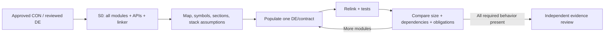

# Implementation discipline: linkable skeleton first

**Status:** User-requested implementation-process improvement, authored as a
reviewable work-branch proposal. Not a retroactive qualification, approved
generic framework gate, or modification to protected AS/AP/CON/DE authority.

**Goal:** Before implementing algorithmic behavior, establish the entire
intended compile/link integration structure in its smallest honest form.
Preserve this first linkable build as the **S0 structural baseline**.
Then populate modules incrementally, measuring structural and resource
growth at every material step.

## Entry and ownership

Entry is an independently reviewed DE/CON and permitted implementation
task, or an explicitly marked **exploratory prototype** with no binding
DE/CON authority. Identify each contract/module owner, public API,
calling boundary, required platform dependencies and target toolchain.
The skeleton must follow approved interfaces, not silently choose new ones.

A DE is a responsibility, not necessarily a C source file. The mapping
from DE to compilation units is recorded and may be many-to-one or
one-to-many. Port/target-specific code belongs in a named portability
layer where applicable. Avoid entangling core logic with HAL/RTOS hooks.

## S0. Linkable structural skeleton

1. Generate *all intended first-scope compilation units*, headers,
   integration adapters, an entrypoint and reproducible build/link
   configuration. Link against only explicitly declared production
   dependencies. A mock may be used in a separate test build, but
   must be named and cannot masquerade as the target HAL.
2. Define externally visible symbols, exact function signatures,
   opaque or explicit state layouts, and the call/dependency edges.
   Record contract/DE provenance for each symbol. Use one
   consistent ownership and linkage policy; no undeclared globals.
3. Provide type-correct minimal function bodies for interfaces not
   yet implemented. Prefer typed `UNIMPLEMENTED` status or
   guarded fail-fast for required operations, not a false success,
   a fabricated reading, or behavior that silently consumes events.
   If a void-return path cannot report absence, make its stub
   unusable by production tests until a real implementation exists.
4. Require the complete planned S0 set to compile **and link** with
   undefined-symbol diagnostics enabled. Add a linker-map and
   cross-reference report. Prohibit unresolved contract entrypoints,
   duplicated global symbols, accidental circular dependencies
   that violate the DE/CON graph, and hidden host-only services.
5. Run an **S0 smoke test** verifying init/entrypoint linkage and
   manifest/symbol existence. No functional tests may be marked PASS
   solely because stubs return successfully. Keep independent
   `IMPLEMENTED`, `STUBBED`, `UNAVAILABLE` statuses.
6. Snapshot exact compiler/linker options, target/runtime,
   section inventory and source/object hashes. Do not count a
   host executable as qualified Cortex-M evidence.

## Early structural and resource observations

Capture, when supported by the toolchain:

- `-Wl,-Map=build/skeleton.map,--cref` for linker resolution and
  cross references; the exact option syntax is toolchain-specific.
- `nm -S --size-sort` for retained global/local symbols and sizes.
- `size -A` and `readelf -SW` for `.text`, `.rodata`, `.data`,
  `.bss`, veneers, alignment, initialization/copy sections,
  and target-specific retained sections.
- `-fstack-usage` or target-supported static stack analysis for
  per-function stack estimates. These are not automatically
  whole-call-graph peaks, interrupt nesting or runtime stack proof.
- Library/port object inventory, missing stubs, callback/ISR
  bindings, whole-program symbol graph, linker warnings, and
  link-time garbage collection decisions.

**Target memory ownership matters:** if code and constants execute
from SRAM, include resident `.text`, `.rodata`, relocation/copy
data, any linked runtime/library code and all other charged sections
in the same SRAM budget. If code executes from flash, do not count
its flash residence as live SRAM without a project-specific reason.
For detector-attributable RAM include persistent state, live scratch,
buffers, shared attributions, index/output debt, and stack. Do not
double count `.data` load and runtime addresses; account both memory
regions where relevant.

Report separate **S0 baseline**, **current populated build**,
**measured delta**, **remaining budget** and **UNKNOWN/NOT ACCOUNTED**
values. A tiny skeleton is an early lower-bound observation for its
chosen build, never a proof of final fit or worst-case stack/energy.
Optimization and linker garbage collection can remove unused stubs;
ensure intended entrypoints are reachable or retained and disclose
what was eliminated. Check link status of a **complete integration
scope**, not a cherry-picked numerical kernel.

## S1..Sn. Controlled population

For each reviewed contract/design element:

1. Replace a named stub with behavior and real dependencies.
2. Rerun compile/link; enforce symbol/contract consistency.
3. Run relevant deterministic positive/negative tests, including
   failures, reset, event ordering and initialization.
4. Diff map/sections, peak-live memory assumptions, stack estimates,
   external dependencies and unresolved obligations from S0 and the
   preceding revision.
5. Update the obligation-to-implementation trace and progress briefing.
   Explain large footprint jumps, new runtime allocation, new link
   dependencies or inter-module coupling before continuing.
6. Require no unexpected remaining stubs in any scope described as
   fully implemented. Independent verification and target evidence
   remain separate gates.



## Versioned skeleton evidence contract (proposed)

```yaml
schema: proposed-pc-linkable-skeleton-evidence/v0
build_revision: "<exact source commit>"
toolchain: {target: "<target>", compiler: "<version>", linker: "<version>"}
build_scope: "<all planned modules / ports / libraries>"
link_result: {exit_code: null, map_file: null, unresolved_symbols: null}
module_contract_map: []
symbols: {defined: null, missing: null, duplicated: null}
stub_manifest: {required: [], intentionally_unimplemented: []}
section_bytes:
  text: null
  rodata: null
  data: null
  bss: null
  other_resident: null
charged_memory_regions: []
stack: {analysis_method: UNKNOWN, peak_bytes: null}
baseline_scope: STRUCTURAL_ONLY
functional_correctness: NOT_ESTABLISHED
target_qualification: NOT_ESTABLISHED
source_hashes: {}
next_population_step: "<named DE / contract>"
```

## Tests for the rule itself

- A missing required externally referenced symbol fails link.
- A duplicate implementation of a required global symbol fails link.
- An intentional stub remains identifiable and cannot satisfy
  functional evidence/VO by accidentally returning success.
- A new static dependency or library appears in the map delta.
- A seemingly small skeleton's missing/nonretained modules are
  caught by the symbol/entrypoint manifest.
- Changing the linker script's section placement changes the correct
  charged-memory region, including SRAM-resident executable code.
- A target stack estimate is labeled incomplete until all call
  and interrupt paths are analyzed.
- A late interface change triggers appropriate contract/DE impact
  assessment, not a hidden prototype-only change.

## Relation to CLN-001

The exploratory A/B and FLOW-002 C prototypes were already implemented
before this guideline was proposed; **do not claim they had an S0
linkable skeleton milestone retroactively**. On the next separately
authorized implementation stage, begin with S0, capture link/map/symbol
baseline and populate in traceable increments.

The CLN-001 2048-byte RAM gate applies to detector-attributable
memory under its actual ownership policy; the host C object
`sizeof` values are not complete peak-live RAM evidence. The active
Toy1 diagnostic's Stage-12 IF11 review remains independent of this
proposal. A separate generic process review is required before making
this a protected mandatory implementation gate throughout Archbot.
