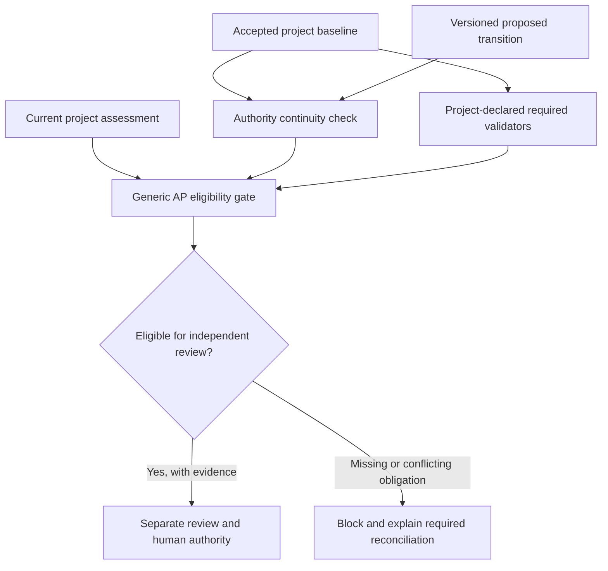

# PC-COOPERATIVE-AUDIENCE-001: cooperative operating model and FR-002 redirection

**Status:** Engineering direction accepted, design-only; no revised implementation accepted.  
**Authority:** [user decision](../process/decisions/PC-COOPERATIVE-AUDIENCE-001.yaml).  
**Historical source:** FR-002 original independent review returned `REVISE` because a policy could be changed and re-pinned to remove the C-002 validator. The R1 candidate addressed this by hardcoding Toy 1's trusted file identities into the engine. Both findings and the R1 local test receipt remain historical evidence. They are **not** rescinded or converted into acceptance.

## 1. Threat model and what correctness means

The framework targets cooperative engineers and agents working within the specified behavioral protocol. They may make mistakes, forget a step, misroute evidence, rely on stale context, or inadvertently drop a requirement. We do not assume they attempt to forge approvals, fabricate immutable history, or overwrite both the engine and every authority source maliciously.

We require **engineering authority continuity**, not tamper resistance:

1. The active project baseline identifies the governing set of accepted requirements, policies, scope decisions, validators, reviewers and VO/AD ledgers.
2. Any change to an accepted obligation is explicit, versioned, reviewed as required and subject to the responsible human engineering authority.
3. The stage gate compares the current candidate with that accepted baseline. It reports a missing/mismatched obligation instead of silently omitting a validator.
4. Historical hashes and exact source revisions establish reproducibility. They never independently confer human approval.
5. The generic engine is the *same for every project*. New projects provide their own accepted baselines, review receipts, scopes and validators rather than requiring a new hardcoded entry in shared source.

This is not a relaxation of C-002 or other product requirements. C-002's 2048-byte charged-SRAM rule remains binding until its accepted authority explicitly changes it.

## 2. Preferred architecture

The baseline and its recorded provenance are owned by the project. The engine may check mandatory fields, typed relations, applicability, approved decisions and source identity but must not embed `AS-001`, `C-002`, Toy 1 SHA-1 hashes or a permanent list of trusted project names.

## 3. What to preserve from FR-002

Retain the useful `tools/gates/common.py` separation, Toy 1's `toy1_c002.py` validator and explicit gate inputs. Continue rejecting:

- Missing or mismatched active project baseline or stage policy.
- A validator required by the accepted baseline but omitted in the proposed gate invocation.
- A previously accepted protected constraint removed without a recorded and reviewed transition.
- An incorrect project, stale binding, cross-project ledger or missing source-evidence link.
- Premature VO discharge, unjustified AP deferral or unapproved comparison/tradeoff.

Do **not** require the generic engine itself to whitelist the SHA-1 of each new project's accepted policies and reviewer receipts.

## 4. Proposed FR-002 replacement, not yet implemented

Replace `tools/gates/authority_roots.py` as a production per-project allowlist with an explicit project-owned, versioned **baseline authority projection** that includes required validators, accepted scope decisions, governing AP policy and active VO/AD references.

For current Toy 1, build that projection additively from existing accepted source documents. Do not rewrite accepted baseline, policy, scope decision or VO/AD ledgers merely to make them fit a new schema. Any new project-owned projection needs evidence tying it to the accepted baseline and its authority. Treat it as a candidate until reviewed.

Required versioned tests:

- Toy 1 still enforces C-002, seven charged SRAM categories, positive margin, authority and original negative gates.
- Omitting C-002 without a transition conflicts with the accepted baseline.
- An explicitly versioned, reviewed and authorized transition may legitimately replace a requirement or validator; the framework must not permanently prohibit change.
- A separately defined synthetic root-solver project can use the same generic mechanics without editing an `AS-001` engine registry. This does not assert synthetic project authority.
- Old review receipts, source pins and logs remain immutable.

## 5. Existing review task and next gate

The authored `REVIEW_FR002_GATE_ADAPTER_R1-001` playbook currently attempts to qualify the earlier, adversarial engine-root design. **Do not execute it as the active acceptance gate.** It remains a historical, unexecuted task. Retain its original pins, test receipt and playbook for traceability.

First author a separately versioned bounded FR-002 replacement proposal and obtain the required source-edit authority under the cooperative operating assumption. Implement, collect the human's local test evidence, then route a **new** independent reviewer task judging authority continuity, not hostile forgery. Do not silently label the previous R1 code accepted.

The cleanroom later still needs protection from **accidental previous-solution exposure**, regardless of cooperative users. Security requirements in an actual product remain binding if separately authorized.

**Non-claims:** No source replacement is implemented by this design record; no framework freeze, cleanroom approval, target verification, VO discharge, AD change, or final F-001 result is created.
