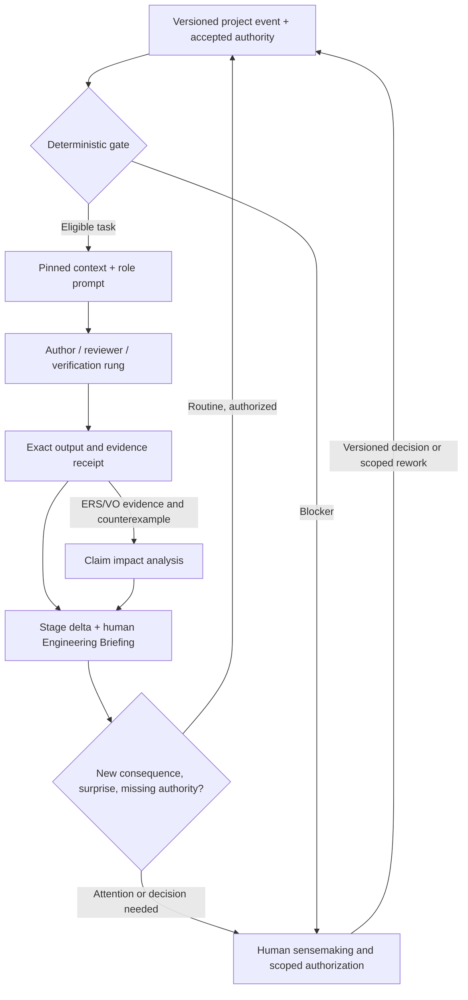

# Process Orchestrator and Human Attention Contract

**Status:** PROPOSED ARCHITECTURE; NOT IMPLEMENTED OR PROCESS-APPROVED.  
**Context:** Progressive Concretization, the Stage-1 through Stage-6
CLN-001 pipe-cleaner, `theory_of_operation.md`, the ERS/rung
verification theory, and the project-owned interaction archive.
**Intent:** Reduce mechanical prompting while increasing the quality
and timeliness of human engineering understanding.

## 1. Operating principle

An engineering workflow is an **investigation**, not a recipe.
Novel measurements, overlooked relationships, proof counterexamples,
conflicting assumptions and human insight can invalidate a plan
at ANY stage, including after an earlier scoped PASS.

The human's cognitive effort should be spent on:
- recalling facts the model cannot know, including operating context;
- discovering relationships among goals, physical behavior, interfaces,
  safety boundaries, costs and absent evidence;
- challenging conclusions and requesting different experiments;
- exploring alternatives and connecting apparently unrelated findings;
- authorizing consequential, scoped engineering commitments.

The system owns routine, inspectable work: choosing the next **eligible**
role, assembling correct context, preparing the prompt/workspace,
running or scheduling an authorized task, verifying receipt syntax
and file identity, archiving evidence, arranging separate review,
recovering interrupted handoffs, and explaining the stage's meaning.

**Reporting every stage is mandatory in the proposed interaction
contract, but requiring human approval at every routine stage is NOT.**
A human may request more detail at any time.

## 2. Two-layer architecture, one durable event history

**Deterministic workflow and gate engine**
- Reads project/spine/role context and the applicable accepted authority,
  prerequisite receipts, open VOs/AD, ERS claim/rung state.
- Chooses allowable stage transitions from typed events, not from LLM
  optimism. `READY_FOR_DELEGATED_DISPOSITION` is never auto-approval.
- Builds source-hashed positive-allowlist inputs and output contracts;
  enforces different invocations for author and independent reviewer.
- Validates outputs, tracks actual runtime and execution provenance,
  preserves original bytes, commits to a controlled Git destination and
  resumes interrupted copies, stages or pushes without false success.
- Stops and routes missing authority, conflicting evidence or failed
  mandatory checks to a human-authorized decision or repair task.
- Does not equate a new directory with a real OS sandbox or connector
  isolation; those require explicit runtime evidence.

**Process dialogue and sensemaking agent**
- Presents a compact stage-to-stage explanation, not merely a status code.
- Connects new evidence to accepted goals and prior uncertainty.
- Identifies plausible unmodeled factors, contradictions, domain gaps,
  alternate interpretations, tests that might falsify the conclusion,
  and the cost of being wrong.
- Drafts precise human questions and source-linked decision alternatives,
  with consequences of acting, deferring or changing scope.
- Suggests next investigations or expanding the agent's projected
  context, but cannot bind requirements, accept its own work, declare
  proof/VO discharge, or choose an AP without authorization.
- Preserves original evidence, including results it summarizes poorly
  or cannot explain; humans and other agents can inspect and challenge it.



The orchestrator's final authority remains the project-specific
approved baseline and independent gate records, not its summary.

## 3. The mandatory stage briefing

The same versioned schema conceptually supports AS, Proof Scout,
Proof Engineer, F, AP, CON, DE, implementation, ERS, ladder and
verification-rung events. It is a **human-facing projection**
with links to the complete retained artifact graph.

| Field | Engineering purpose |
| --- | --- |
| Stage ID, input/output source hashes, reviewer and scope | Know exactly what this briefing describes |
| Newly established facts versus models/conjectures | Avoid accidental promotion of uncertainty into authority |
| Deltas from preceding checkpoint | Preserve continuity without rereading everything |
| Goal connections and affected AS/F/P/CON/DE | Show why the result matters outside the agent's task |
| Surprise, discrepancy or counterexample | Surface overlooked or unmodeled relationships |
| Changed ERS claims, ladder branches, VOs and AD | Show what must now be verified or reopened |
| Residual uncertainty and possible falsifiers | Resist false confidence from polished text |
| Proposed next experiment with cost/benefit | Facilitate informed prioritization |
| Human question, alternatives, authority required | Ask only what requires creativity or binding judgment |
| Next authorized action, stop reason, full evidence links | Make continuation safe and resumable |

The summary must distinguish:
- **The author claims** from **the independent reviewer accepted**.
- **Mathematical scope** from **model correspondence** and
  **firmware/target qualification**.
- **Not inspected** from **inspected and negative**.
- **Approved source** from **newly proposed requirement, interpretation
  or optimization preference**.

A briefing may say "unexpected result; current explanation UNKNOWN".
It must not fill a gap with a plausible story. Human corrections are
recorded as attributable, versioned project events, not retroactively
inserted into prior agent evidence.

### Attention routing (proposed policy)

- **Routine:** brief the human after each stage; continue automatically
  only when the deterministic gate and applicable prior authority allow.
- **Insight candidate:** unusual pattern, tradeoff, new coupling,
  unexpected but nonblocking counterexample, or potential opportunity.
  Surface it prominently with relevant evidence and continue
  unrelated authorized tasks.
- **Decision required:** new requirement interpretation, unowned
  assumption, disputed scope, AP/AD commitment or changed F objective.
  Hold dependent work for explicit scoped authority; do not block
  unrelated tasks unnecessarily.
- **Critical contradiction:** evidence falsifies a protected premise,
  independent reviewer finds a blocking defect, or a model/target
  gap makes a safety/feasibility claim unsupportable. Interrupt
  affected work immediately, report impact and possible rollback/
  repair, preserve earlier receipts and request human intervention.

These categories and any interruption urgency are **proposals**.
Specific project risk policy must be reviewed before enforcement.

## 4. ERS and verification ladder belong in the orchestration loop

The ERS is the source-traceable, verification-facing **claim
inventory**, not a competing authority for firmware behavior.
It includes admissible domain, falsifier, oracle, source, due stage
and explicit non-claims. A source coverage check alone is not a
semantic completeness proof: independent review and human questions
can reveal the omitted claim.

The verification ladder is a claim-directed **dependency DAG**.
A rung is authorized only with required predecessor evidence.
Results may support, contradict or leave claims unresolved.
Interactions may be represented as sparse typed edges and
higher-order hyperedges. An unmodeled interaction becomes a candidate
for research, not an assumed independence theorem.

After any important result, the orchestrator updates or proposes
a scoped **claim-impact traversal**: Which original requirement,
proof assumption, F comparison, AP/CON/DE commitment, ERS record,
ladder rung, reviewer receipt or VO might change? Only valid
authority can accept resulting changes. A late counterexample
must be capable of stopping or reopening an earlier branch.

The existing `VK-001` provides a bounded deterministic slice
for ERS authoring, supplied rung-plan validation and MODEL_ONLY
execution with independent review. It is **not** a general
discovery engine or proof of target qualification. Avoid claiming
this orchestration layer is already implemented.

## 5. Event and transition sketch (non-normative)

A possible event envelope:

```yaml
schema: proposed-pc-process-event/v0
project_id: TOY2
event_id: TASK-001-COMPLETED
source_revision: <exact-commit>
task_manifest: <project-local-task>
role: architecture-agent
auth_scope: <accepted-authority-reference>
inputs: [<source-identity>]
outputs: [<original-source-identity>]
review_disposition: PENDING
open_obligations: [<tracked-VO-reference>]
new_findings: [<source-linked-finding>]
human_briefing: <artifact-path>
human_intervention:
  needed: <determined-by-gate-and-finding>
  status: NOT_YET_PROVIDED
next_eligible_task: <gate-derived-or-null>
```

Events are immutable, refer to exact source revisions and
carry separate *claim status*, *review status*, and *authority
status*. No runtime should reinterpret a staged receipt as
accepted evidence. Derived spines and concise human views
may be regenerated, but original sources and human discourse
retain full provenance.

## 6. Failure handling demonstrated by Toy 1

The CLN-001 diagnostic gives concrete, repeatable process tests:

1. Missing reviewer JSON must cause an explicit incomplete-output
   state, not a fabricated verdict or silent advancement.
2. A stale author-local self-review must not be substituted for
   a separately archived independent reviewer receipt.
3. Lost shell variables or nonexistent reviewer directories should
   be replaced by versioned preparation manifests and deterministic
   workspace creation, not human guesswork.
4. Re-running a partially executed archival step must verify existing
   identical files, previously staged data and committed evidence,
   then continue safely instead of silently failing.
5. Markdown trailing spaces in immutable evidence must not corrupt
   hashes or become a semantic rejection; style checks should report
   their proper scope.
6. A conditional math theorem (the complete-state/no-replay T2
   bound) must not be promoted into a detector-owned SRAM finding.
7. Missing exact logical-index lifetime/ownership is an opportunity
   for human insight and later contract clarification, not something
   a process agent should silently guess.

A replay harness can run the deterministic transition decisions
over the **recorded receipts and deliberate failure fixtures**,
while separately testing whether a human can understand the
briefings. No new Toy 1 technical result is implied.

## 7. Readiness for Toy 2

A staged development path, with separate authorization at each gate:

1. **Design review:** approve or revise event contracts, gate
   ownership, source projections, briefing format and escalation.
2. **Toy 1 offline replay:** build a minimal Python orchestrator
   around existing `tools/task.py`, `tools/next_task.py` and
   project spine/receipt records. No Node.js dependency required.
   Verify selection, recovery, approval boundaries and surprises
   without launching uncontrolled agents.
3. **Bounded live replay:** automate context preparation and
   dispatch/review for a small set of tasks, with authentic
   separate agent sessions and truthful isolation claims.
4. **Human-interface evaluation:** compare concise briefings
   against original evidence and record what humans notice,
   question, miss or misinterpret. Optimize for engineering
   insight, not just token count or automatic stage throughput.
5. **Toy 2 qualification:** new domain and BKP, reuse generic
   framework, measure human minutes, interventions, repeated
   prompts, review cycles, missed critical findings, false
   escalations, source/authority mistakes, context isolation,
   costs and successful recovery from interruption.

No automatic Git write, remote push, credential use, agent launch
or autonomous delegated approval is authorized by this proposal
alone. Such actions require an approved implementation policy
and permissions. Existing Toy 1 AP/verification work remains on
its recorded path until the human changes priorities.

## Related source material

- `theory_of_operation.md` (including sections 7.1 and 10.1)
- `docs/THEORY_OF_VERIFICATION.md`
- `docs/VERIFICATION_FRAMEWORK_REQUIREMENTS.md`
- `docs/VERIFICATION_SLICE_VK001.md`
- `docs/PROJECT_INTERACTION_ARCHIVE_PROPOSAL.md`
- `docs/QUALIFICATION_CAMPAIGN.md`
- `process/roadmaps/PC_ROADMAP_CURRENT.yaml`

**Proposal only.** This document does not activate an orchestrator,
approve a new gate, change protected acceptance, or discharge a VO.
