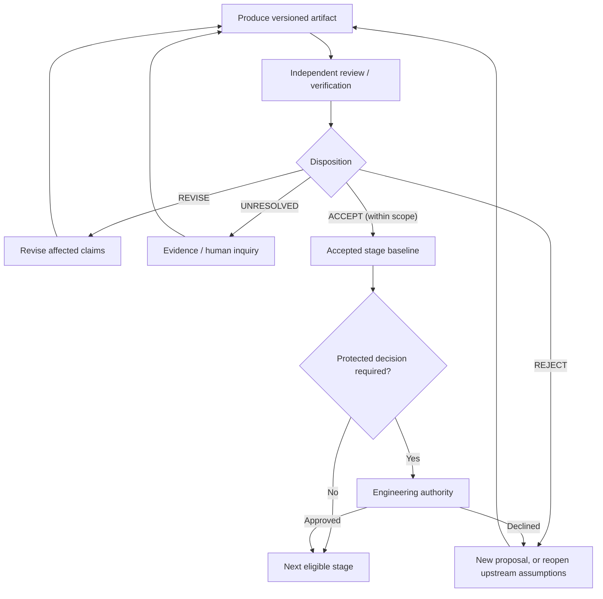

# Progressive Iteration: reviewable stages as guarded state machines

**Status:** Architectural rule adopted for workflow design. Generic routing implemented
for configured transitions; only CON transitions are currently registered for
end-to-end local execution. Remaining stages require their own role/playbook and
receipt adapters before the engine can run them.

## Governing principle

Any Progressive Concretization stage that produces a claim or artifact which
requires review or verification must be *revisitable* without altering the
static prompts, agent roles, or process code for an ordinary correction.

Iteration belongs to the workflow controller, not to one particular stage.

A stage instance is described by:

- A **subject** (the architecture spine and source artifact revision).
- A **stage** (AS, proof, AP, CON, DE, implementation, target validation).
- A **producer operation** and a distinct **reviewer operation**.
- A declared set of **binding and due verification obligations**.
- A **receipt** identifying exactly which claims passed, failed, or remain open.
- An **authority level** specifying what the current reviewer can accept.
- A guarded **transition policy** determining the next eligible operation.

The common progression is:



The labels are **semantic state classes**, not proof that all stage-specific
receipt schemas already implement this normalized vocabulary.

## Review outcomes and control effects

| Outcome | Meaning | Controller action |
|---|---|---|
| ACCEPT | Reviewer accepts specifically scoped claims | Record baseline; check next-stage permissions |
| ACCEPT_WITH_CLARIFICATIONS | Accepted claims and residual qualifications are explicit | Record qualifications and ensure no due obligation is missing |
| REVISE | One or more actionable defects in current artifact | Generate a revision task referencing findings |
| UNRESOLVED | Insufficient evidence to judge a due claim | Generate evidence task or human inquiry, not another speculative rewrite |
| REJECT | Claim or approach is unsuitable under current assumptions | Reopen alternative proposal or affected upstream claim |
| AUTHORITY_REQUIRED | Valid engineering tradeoff needs protected approval | Block protected transition until accepted human decision |
| VERIFIED_FINAL | Required verification evidence accepted and all due VOs discharged | Permit final acceptance only if all other gates and authorizations pass |

No rule treats exit code zero, generated prose, or a green structural check as
approval. Protected authority changes require an exact decision record, not a
chat inference or a reviewer recommendation.

## Generalized artifact loop examples

| Stage | Producer | Reviewer / verifier | Example revision trigger |
|---|---|---|---|
| BKP / AS | Evidence curator / Architecture Agent | Independent source / AS reviewer | Unsupported requirement interpretation |
| Proof | Proof Engineer | Proof Reviewer | Invalid lemma or missing assumption |
| AP evaluation | Evaluation Agent | Independent Evaluation Reviewer | Inadmissible F comparison |
| CON | Contract Agent | Contract Reviewer | Unsatisfiable interface precondition |
| DE | Design Agent | Independent Design Reviewer | State owner or scheduling design violates CON |
| C implementation | Implementation Agent | Conformance / code reviewer | Arithmetic mapping or initialization bug |
| Target validation | Verification Agent | Independent evidence assessor | WCET evidence excludes ISR interference |

For all stages: original results remain versioned; new drafts identify exact
source revisions and related finding IDs. Each source of authority remains
unchanged unless there is an independent, separately authorized amendment.

## Important: revisiting downstream results may reopen upstream claims

The process is a dependency graph, not just a chain of local loops.

If an implementation fails an accepted CON precondition, review the specific
CON claim and its dependents. If an accepted proof is invalidated, every AP,
CON, DE, and implementation claim relying on that theorem must be flagged
for impact analysis. Do not invalidate unrelated accepted findings.

Conceptually, a changed claim `x` requires a review of the dependent set:

```text
Impact(x) = {y | there is a typed dependency path from y to x}
```

This is a review set, **not automatic revocation**. A dependency might remain
valid under a weaker assumption; the reviewer determines actual impact.

## Progress and termination

An iterative stage does not automatically terminate merely because an agent
repeatedly generates revised text. Record:

- Open and newly resolved material findings, with independent acceptance.
- Whether a new run changed the evidence, model, or substantive obligation.
- Artifacts read/created, and bytes of context selected versus actually read.
- Repeat counts, elapsed run time, tokens and human interventions.
- The minimal unresolved assumption, fact or engineering decision.

Escalate when the same issue is repeated without new evidence or when
additional mechanisms keep creating new obligations without improving
feasibility. A reviewed stable baseline is a **scoped fixed point** under
available evidence, not globally optimal architecture.

## Separate correctness closure from cost optimization

The human has requested **analyze, then optimize**.

1. Close or explicitly defer all *due* correctness and interface obligations.
2. Assemble the complete dependency and resource picture.
3. Construct a symbolic `F_s` cost model for alternative refinements.
4. Propose simplifications with equivalence/refinement obligations.
5. Independently review the optimized candidate; do not silently rewrite
   the baseline or alter F's protected objectives.
6. Compare final `F_f` evidence and reconcile meaningful discrepancies.

This avoids optimizing one contract clause while other interface constraints
remain unknown, and avoids letting toy experiments accumulate unnecessarily
complex mechanisms.

## Missing evidence is not a revision verdict

A producer may explicitly report a stage as `UNRESOLVED` even after
meaningful progress. That outcome does **not** authorize an independent
acceptance review of a knowingly incomplete artifact. The generic
controller should route to evidence planning or a scoped human inquiry.

The implemented CON adapter now recognizes:
- `pc-gate-receipt/v1` with `CONTRACTS_UNRESOLVED` and a nonempty
  `unresolved` list: send the receipt to `PLAN_EVIDENCE` without
  mutating the CON baseline.
- `pc-evidence-plan/v1` with `EVIDENCE_PLAN_READY_FOR_REVISION`:
  return the actionable plan to the existing `REVISE_CON` operation.
  The plan is not itself accepted CON evidence or a VO discharge.
- `EVIDENCE_STILL_UNRESOLVED`: no automatic advancement; clarify the
  missing evidence or obtain an appropriate authority decision.

The `PLAN_EVIDENCE` playbook is stage-independent. Other stages can add
a policy row for their own unresolved receipt semantics without rewriting
the workflow engine. Generated manifests reference predecessor tasks rather
than embedding entire previous contexts.

## Software architecture and current implementation boundary

There are **three different layers**:

1. `tools/next_task.py`: generic receipt/manifest planner. It matches
   declarative transitions, selects a versioned source receipt or typed
   concept artifact and produces an idempotent next task manifest.
2. `process/loop_transitions.yaml`: currently defines only
   `CONTRACT_REVIEW` correction and review transitions. Future proof,
   AP, DE, implementation and target adapters must be approved and added
   here *once per stage type*, not once per iteration or toy problem.
3. `process/operations.yaml` and reusable playbooks: define which agent
   may execute each operation. Specialized checkers establish stage
   evidence, not the generic workflow controller.

The planner handles `target: changed_concept` with configured OKF
`concept_type` and `related_concept_type`; it is not restricted to a
Contract Spine. Historical `changed_contract_spine` rules are still
recognized for compatibility.

Task manifests now carry references to their predecessor manifest rather
than recursively embedding its entire context. Existing older manifests
remain valid historical data. This is important for memory and token
bounds in repeated review loops.

This mechanism **does not** yet automate protected acceptance, graph-based
invalidation, interruption, human interrogation, or unattended agent
scheduling. Those require separate controller/authority tests.

## Qualification gates

Before claiming broad reusability, demonstrate:

1. A proof review failure routes to proof revision using a versioned receipt.
2. A contract review failure routes to contract revision using the same
   controller implementation, with distinct playbooks.
3. A DE review failure revisits only affected DE and CON obligations.
4. An implementation failure can reopen the right design or proof node.
5. A later source invalidation produces a scoped impact review.
6. A positive review cannot silently approve a protected architecture change.
7. Toy 2 reuses the controller and role/playbook definitions without changing
   framework code to fit its problem-specific symbols or parameters.
8. Long sequences of generated manifests stay bounded in size because they
   reference prior task context, rather than recursively copying it.

Only the **generic planning mechanism** and synthetic cross-artifact
regressions are presently committed. The remaining stage adapters and
end-to-end claims are pending.
