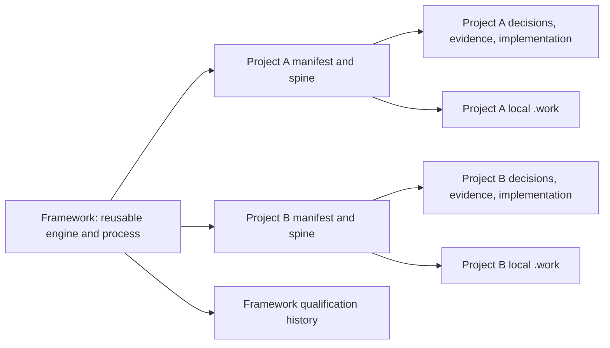

# Archbot filesystem boundary: permanent framework, replaceable projects

**Status:** Approved *direction* from the human operator; **proposed layout**, not a completed directory migration.  
**Machine-readable layout:** [PC-PROJECT-BOUNDARY-001](../process/layout/PC_PROJECT_BOUNDARY_001.yaml).  
**Implementation scope proposal:** [PC-PROJECT-ISOLATION-MIGRATION-001](../process/proposals/PC_PROJECT_ISOLATION_MIGRATION_001.yaml).

## 1. Non-negotiable user experience

An engineer should be able to install Archbot once, add a project by copying a self-contained directory into `projects/`, and start a new project without inheriting any unrelated project's authority, design, evidence or conversation history. To reset the active workspace, remove that project's folder. No source edit in the reusable engine or global project registry should be necessary to discover another project.

Project deletion is **intentional deletion of active project files**. It must not silently delete framework code or qualification evidence about the framework. Projects have their *own* review and engineering history inside their folders. Keep backups or export the project first if those records matter.

## 2. Proposed final tree

```text
archbot/
├── AGENTS.md                      # Stable tool-level startup contract
├── README.md
├── framework/                     # Permanent, installed once
│   ├── core/                      # Generic CLI and source
│   ├── agents/                    # Reusable role definitions
│   ├── process/                   # Generic workflows, playbooks, schemas
│   ├── templates/                 # Empty project bootstrap templates
│   ├── tests/                     # Generic machinery regression tests
│   ├── docs/                      # Theory and process guidance
│   └── qualification/             # Framework's own audit/review/roadmap
├── projects/                      # Replaceable, self-contained bundles
│   ├── AS-001/                    # Current Toy 1, after migration
│   │   ├── project.yaml           # Project contract and root pointers
│   │   ├── PROJECT_SPINE.md       # Project-only context index
│   │   ├── knowledge/             # BKP, AS, proofs, CON, DE, etc.
│   │   ├── process/               # Local policies, decisions, tasks, ledgers
│   │   ├── adapters/              # Project-specific validators
│   │   ├── implementation/        # Product-specific code
│   │   ├── tests/                 # Domain/implementation tests
│   │   ├── reviews/               # Project engineering review/evidence
│   │   └── .work/                 # Untracked scratch, logs, generated files
│   └── ROOT-002/                 # Independent numerical solver project
└── exports/                       # Explicit optional exports, ignored
```

`framework/qualification/` contains qualification of **Archbot itself** (FR-001 through FR-006, framework decisions and its evidence). `projects/<id>/reviews/` contains evidence of a **particular engineering project**, never a claim that the whole tool is qualified.

The optional `exports/` directory is never searched automatically for active projects. Project-local `.work/` belongs inside its project folder so deleting that folder also clears its local scratch. The framework must never create an implicit hidden global current-project selector that survives a project deletion.

## 3. Explicit project manifest

A project may be named by its folder and declared ID, but the engine must never infer authority from a filename alone.

```yaml
schema: pc-project-bundle/v1
project_id: ROOT-002
framework_contract_version: pc-project-bundle/v1
bundle_schema_version: 1
project_spine: PROJECT_SPINE.md
roots:
  knowledge: knowledge/
  process: process/
  reviews: reviews/
  implementation: implementation/
  adapters: adapters/
  tests: tests/
active_baseline: null
declared_validators: []
```

This is illustrative, not a currently accepted schema. A newly generated project starts with no architecture commitment, selected AP, reviewed baseline, validator approval, or discharged VO. The manifest declares locations and explicit dependencies, **not stakeholder approval**.

Project discovery should read only `projects/*/project.yaml`. The future CLI should have commands equivalent to:

```text
archbot project list
archbot project init ROOT-002
archbot project inspect ROOT-002
archbot task inspect --project ROOT-002 --manifest process/tasks/TASK.yaml
```

Those commands do not yet exist. The actual interface and entrypoint are implementation decisions. No shared source registry should require adding an `AS-001` entry when a new folder appears.

## 4. Authority and context containment



Normal task and context resolution is **project-root relative**. Required project-local dependencies stay inside the declared project directory. Shared references may enter versioned, generic `framework/` interfaces or templates, never another project's authority or the framework-qualification tree. Any deliberate multi-project comparison requires its own explicit export/transfer and scope.

Project-owned validators travel with the project in `adapters/`; the engine exposes a generic validator interface and registration mechanism, but project data may not implicitly execute arbitrary code by naming a YAML path. Accepted baseline, protected requirements, VO/AD and reviewer authority are **not** established by simply dropping a folder.

## 5. Present repo: source-backed relocation map

| Current path | New owner | Reason |
|---|---|---|
| `agents/`, generic `tools/`, generic `process/playbooks/` and `process/templates/` | `framework/` | Reusable machinery |
| `knowledge/architecture/AS-001/`, `knowledge/bkp/` | `projects/AS-001/knowledge/` | Toy 1 problem, architecture and evidence |
| `implementation/toy1/` | `projects/AS-001/implementation/` | Product C implementation |
| `process/baselines/`, `process/policies/`, `process/ledgers/`, project task/gate configs | `projects/AS-001/process/` | Accepted project authority and local workflow |
| `reviews/gates/`, `reviews/verification/`, legacy project review files | `projects/AS-001/reviews/` | Toy 1 review/verification history |
| `tools/gates/toy1_c002.py`, `tools/toy1_*_evidence.py`, Toy 1 tests | `projects/AS-001/adapters/` and `tests/` | Currently project-specific executable behavior |
| `reviews/qualification/`, `process/roadmaps/`, FR-specific approvals, genericity studies | `framework/qualification/` | Evaluations and authority for Archbot itself |
| `runs/`, caches, local logs | `projects/<id>/.work/` | Disposable execution output |
| `prompts/`, `process/tasks/`, `process/decisions/`, `docs/`, `tests/` | Classify **per file** | Today they contain a mixture of generic and Toy 1 content |

This is a classification and target plan, **not a performed move**. Historical Git revisions must continue to resolve their *original* paths after relocation; don't mutate older review receipts to say they originally referenced the new location.

## 6. Existing code that blocks a drop-in project

A few concrete couplings from the current checked-in sources:

- `tools/pc.py` uses a repository-level knowledge root and `knowledge/architecture/AS-001/evidence/manifest.json`.
- `tools/task.py` expects review tasks in `process/tasks/`, and its reviewer evidence paths assume root-level `reviews/`.
- `tools/telemetry.py` uses root-level `knowledge/`, `reviews/` and `runs/` for context/export/reporting.
- `tools/gates/binding.py` imports the Toy 1 validator into its default registry and expects `knowledge/architecture/<id>` paths.
- Existing review manifests and historical receipts pin **exact old paths and revisions**.

These are migration tasks, not reasons to abandon a project-root model. Move the **generic routing abstractions** with care, not by string-replacing accepted evidence files.

## 7. Delivery plan: one user-facing capability, not another polishing loop

**Migration candidate (separately authorized):** introduce a project-root resolver and manifest contract, move or wrap generic source under `framework/`, move Toy 1 active source/authority/implementation/reviews under `projects/AS-001/`, move project-specific validators and fixtures into that bundle, update active references and source tests with proper new versions, and qualify existing Toy 1 behavior at its migrated project root. Keep historical source references retrievable at old Git revisions.

Then verify five product-facing acceptance cases:

1. Empty `projects/` means **no project selected**, not an implicit Toy 1.
2. Drop `projects/AS-001/` into an installed framework, inspect and run it without editing shared code.
3. Install a distinct second project and demonstrate no cross-project context, authority, validator or review bleed.
4. Delete the first project folder and confirm discovery, startup, routing and next projects do not use its former active artifacts.
5. Initialize a fresh **unsolved** project from a framework template with an empty spine and no prior solution. Feed this bootstrap into FR-005's positive-allowlist preparation.

This is the point of the change: a project becomes a replaceable input to a reusable process. Do not spend weeks solely renaming directories; the first integration demonstration is the acceptance gate.

## 8. Two important limitations

**Git history:** removing `projects/AS-001/` from the working tree does **not** remove the original files from the repository's Git history, remote copies or external memory. That is acceptable for a normal new active project, but it is **not sufficient for cleanroom isolation**. FR-005 still needs a package containing only positive-allowlisted files, without old `.git` history, solution transcripts or evaluator-only data.

**Migration versus authority:** moving project data can change path-embedded evidence, reviewed selectors and content digests. A changed path is a new source identity and must not be made to look like an accepted historical path. New project-root references need an explicit, versioned migration mapping and appropriate reviews, not mutation of original accepted receipts. The migration does not discharge Toy 1 VO-002..VO-006 or complete F-001.

**Current status:** proposed architecture, not a working delete/drop interface. FR-004, framework freeze and cleanroom execution remain separately gated.

## 9. Installation model: independent project repositories and optional Git submodules

**Selected direction:** Prefer each maintained engineering project to own an
independent repository and be installed as a Git submodule at
`projects/<project_id>/`. Git submodules supply a reproducible parent
Gitlink pointing to one project commit. They are **not required** for
project discovery: copied folders and independent nested checkouts with
a valid `project.yaml` remain usable, and discovery never silently
selects a default project.

Git operations are not engineering approval. `git submodule deinit`
unloads a worktree but leaves the parent Gitlink; permanently removing
a submodule registration changes the parent repo and `.gitmodules`.
Deleting an ordinary folder removes visible active state, not prior
remote/Git backups. Original Toy 1 review receipts retain their old
monorepo path/revision identities and must not be rewritten during
extraction. After migration, source identity includes repository
identity as well as commit, path and digest.

**Phase A foundation authored:** `framework/core/project_registry.py`
offers `list`, `inspect`, and `init`. The new code checks bundle
manifest, path containment and explicit project selection, recognizes
staged Gitlinks, and never executes declared project validators.
`tests/test_project_registry.py` includes empty-registry, folder
copy, deletion, two-project, alias and Gitlink canaries. This code is
**not yet locally tested or independently reviewed**, and legacy
`task.py` and `telemetry.py` still use root paths. A separate
reviewed Toy 1 repository **does not yet exist**. See
[stage-one runbook](PROJECT_SUBMODULE_MIGRATION_RUNBOOK_001.md).

**Phase B remains unperformed:** classification of mixed files,
independent Toy 1 repository, a real submodule with a verified remote,
project-scoped task/gate/context routing, review of active authority
migration and old-path historical evidence. Do not make destructive
moves under Phase A authorization.
