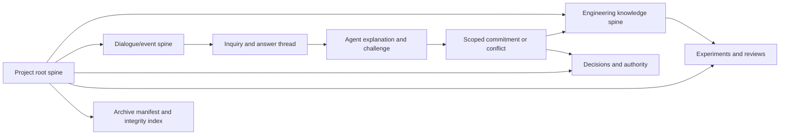

# Project-owned dialogue and inspectable engineering archives

**Status:** Proposed future capability, not implemented or qualified.
**Architecture scope:** Generic Progressive Concretization project root and spine.
**Planned sequence:** Complete current Toy 1 -> genericity audit/freeze ->
cleanroom Toy 1 without dialogue -> implement project-owned collaborative
engineering dialogue -> repeat cleanroom Toy 1 with dialogue -> Toy 2 ->
increase novelty, complexity and scale.

## Project boundary

Every human-agent interaction about an engineering project belongs to
that **project**. It must be traceable from the project's root spine and
must not live only in ephemeral model context, an agent's personal memory,
or a global conversation store with no explicit project association.

All conversation events need a project identifier, originating task/agent,
timestamp or ordered event sequence, parents, related claims and artifacts,
and a reviewable provenance reference. Interactions spanning two projects
must declare their relationship explicitly; do not leak a statement from
one project's authority domain into another.

**No orphan interaction:** A project archive audit must find every
project conversation event by traversing the project's interaction
indexes. Queryable indexes can be generated from immutable source events;
the index alone is not the archival evidence.

## What must be preserved

The project should capture, or reference in its archive manifest:

- Human questions and agent questions, including their motivating
  ambiguity and what remains independently actionable.
- Educational agent explanations: claim, evidence trail, dependencies,
  derivation or concise decision rationale, alternatives, uncertainty,
  counterexamples and prospective consequences. Do not require disclosure
  of private model internal reasoning.
- Human answers, qualifications, corrections, challenges, provisional
  preferences and explicit protected approvals as **different kinds**
  of event. Do not silently promote an answer into a requirement.
- Repeated consistency questions and the **scope** in which answers were
  compared (component, mode, time, version, input domain).
- Suspected contradictions, the two source statements and their
  provenance, competing interpretations, human-agent reconciliation,
  accepted revision or recorded unresolved state.
- Downstream references to BKP, AS, theorem, AP, CON, DE, source,
  test results, review receipts and explicit supersession history.

A contradiction is a hypothesis to investigate; different scope,
new evidence, changed decision or model misunderstanding may reconcile
it. Consistency checking applies equally to the human, the agents,
their evidence, and claims made about proofs.

## Project spine and archive design

Illustrative relationships, not yet part of the active OKF schema:

The **event store** is the authoritative record of conversation events.
The **interaction spine** provides compact, typed navigation into that
record. The **knowledge spine** indexes accepted and disputed engineering
claims derived from interactions. An event may be referenced by multiple
claims, but its origin and project assignment remain unambiguous.

The project must be portable. A self-contained archive should contain
or explicitly account for versioned source artifacts, tasks, role and
playbook versions, event/decision logs, graph edges, accepted receipts,
dependency closures, tool versions, checksums and a machine-readable
manifest. A new engineer should be able to inspect and verify the
archive **offline**, without a live LLM, hosted service, or unrecorded
conversation to reconstruct the decision trail.

The export must identify missing, deliberately redacted or externally
held items. It must never silently claim a complete archive if private
sources, datasets or external evidence are absent.

## Security and privacy boundary

A project-owned interaction does **not** imply that every transcript is
committed to a public repository. Support a private event store and an
export policy. Project-local public spines can contain an approved
summary, reference, provenance and visibility marker while the complete
source remains in a controlled archive. An export must disclose its
completeness/redaction status without exposing protected conversation
content or secrets. Do not publish private chat logs by default.

## Conversational operating principles

1. Agents ask many substantive, exploratory questions and teach as they
   go. Ask about application context and assumptions *before* constructing
   defensive machinery for imagined threats.
2. Agents explain relevant conclusions **before** irreversible
   concretization, including what would falsify them.
3. Agents revisit consequential commitments from new perspectives and
   check agreement under declared scope. They should not repeat
   questions merely to quiz the human.
4. When a discrepancy appears, first test the agent's interpretation
   and scope; then reason collaboratively with the human using the
   smallest conflicting source set. A new position may legitimately
   supersede an old one with recorded rationale.
5. Every substantive conversation produces a durable event or
   referenced source record. Every promotion to BKP/AS/decision uses
   separately authorized evidence and gate semantics.
6. Only affected engineering tasks wait for clarification; unrelated
   independent work remains eligible.

## Qualification experiments

After finishing current Toy 1:

1. Freeze and audit generic engine versus Toy 1-specific validators.
2. Cleanroom Toy 1 without human-agent dialogue layer. Start only with
   authorized BKP/requirements, isolate all prior solutions, and record
   human intervention time, rework and surprise at final implementation.
3. Implement the minimum durable project-specific inbox, explanation,
   challenge, consistency and resumable task protocol. No full GUI is
   required for the first qualification.
4. Run cleanroom Toy 1 again with the same frozen domain challenge,
   declared allowed engineering authority, and conversation protocol.
   Control other framework changes to enable meaningful comparison.
5. Then introduce a genuinely different Toy 2 and later scale the
   number of agents, interacting components and project history.

Pass/fail checks: zero orphan project interactions; accurate original
context for every promoted requirement; no invented authority; human
can ask `why?` and trace the actual source/decision; contradictions
can be distinguished from scoped or superseded claims; archive can be
opened and inspected offline; redacted exports are transparently
marked; project restart does not depend on model chat memory.

This is a **design proposal only**. Do not infer that today's ChatGPT
conversation has already been archived into the OKF graph.
