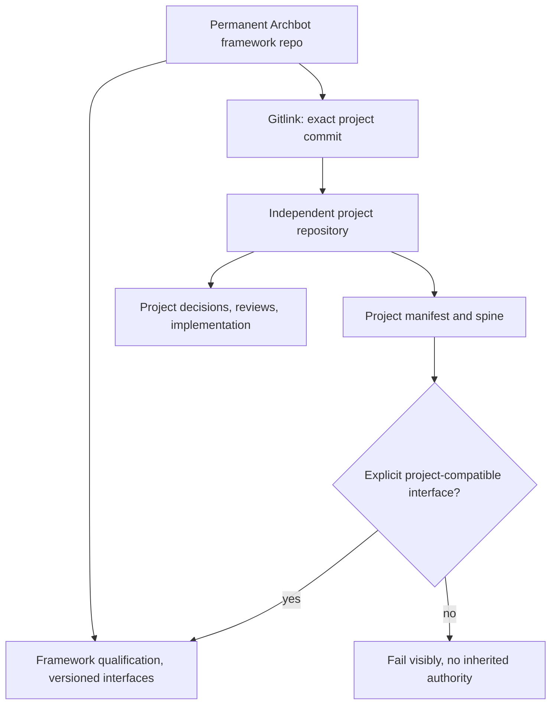

# Submodule-first project migration: execution and safety contract

**PAUSED for the Toy 1 fresh-start pipe-cleaner (2026-10-16).** This plan is
retained for later, not a prerequisite for the next cleanroom diagnostic.
See `docs/CLN_TOY1_PIPE_CLEANER_001.md` for the active test. The M0 local
receipt has now been submitted, but project foundation independent review
and all multi-project milestones are parked.


**State:** planned, NOT yet performed. Stage-one project discovery is
a source candidate; the existing Toy 1 authority, working tree and Git
history have not been moved. See
`process/layout/PC_PROJECT_BOUNDARY_001.yaml` and
`process/decisions/PC-PROJECT-SUBMODULE-FOUNDATION-AUTHORIZATION-001.yaml`.

## Why a submodule, not merely a directory

A project should own its **Git history**, its engineering source, and its
approval/review trail. The parent Archbot repo should pin a specific
project commit without needing to contain that project's source history
or accept its engineering decisions. Submodules provide a Gitlink,
not a second status authority. The Archbot engine continues to accept
ordinary project directories, and does not infer acceptance from either
installation form.



## Phase A: working project installation, no Toy 1 move

The first code slice `framework/core/project_registry.py` supports
`list`, `inspect`, and `init` on `projects/<project_id>/`.
It checks `project.yaml`, relative in-bundle roots, ID equality,
symlinks, declared adapter *paths* (never imports them), and optionally
an existing Gitlink. It can list an empty installation, accept copied
folders, or recognize a checked-out submodule. It does **not** change
`tools/task.py`, `tools/pc.py`, `tools/gates/binding.py`, or the
old Toy 1 evidence paths.

Acceptance: local synthetic tests for an empty project installation,
drop-in project, independent second project, deletion/unregistration by
visible folder disappearance, manifest mismatch, alias rejection,
unreviewed unsolved initializer, and staged local Gitlink identification.
All source/test executions are performed by the human and require a
separate review before acceptance claims.

## Phase B: make a real independent Toy 1 repository

Requires a **real new repository** and an explicit authority/migration
record preserving original source identities. The connected GitHub
tooling here does not currently expose repository creation. The human
may create that repository, then provide the real clone URL.

Do not manually manufacture a fake `.gitmodules` URL or silently
rewrite the accepted Toy 1 review receipts. Before first extraction,
create a file-level ownership mapping for mixed
`process/decisions/`, `process/tasks/`, `reviews/`,
`tools/gates/`, `tests/`, `prompts/` and `docs/`.

The old source identity of a reviewed file stays:
`(archbot repository, old commit, old path, digest)`.
After extraction a newly submitted project file gains a new identity:
`(Toy 1 repository, new commit, new path, digest)`. An explicit
migration mapping links them; equivalence must be checked, not assumed.
This protects FR-003's source-time evidence semantics.

Recommended staged sequence, each with a local test/review gate:
1. Create a separate Toy 1 repository with project-local
   `project.yaml`, `PROJECT_SPINE.md`, all owned BKP/AS/P/AP/CON/DE
   sources, project decisions/VO/AD and reviews, implementation,
   domain validators and tests. Keep legacy originals unchanged.
2. Commit/verify the project-owned source snapshot and its migration
   map. No source approval or VO discharge is implied by copying.
3. Add the real repository as a Git submodule at
   `projects/AS-001`. The parent pins the project commit.
4. Update generic task/context/gate/verification routes to accept
   an explicit selected project root, while preserving legacy historical
   review lookups at their original commit and paths.
5. Run the old Toy 1 accepted canaries, new second-project isolation
   canaries, and portable drop/unload/reload tests.
6. Independently review the migration before removing the old *active*
   paths. Never rewrite archived original receipts or acceptance records.

## Phase C: usability acceptance, not file-renaming theater

The measurable finish line is:
- Fresh Archbot clone with **no projects** has no active project.
- Add a new ordinary folder or existing submodule, then inspect its
  manifest with no engine source edit or global project registry edit.
- Install two distinct projects, select either explicitly, and observe
  no cross-project context or accepted-authority leakage.
- Unload the first project without affecting the second.
- Create a genuinely unsolved third project with empty accepted-state
  fields and no prior solution history.

For a managed submodule, `git submodule deinit` removes its
checkout but retains parent registration; deleting folder contents
is **not** the same as deregistering the Gitlink. For a plain folder,
removing it removes the visible active project but not remote/backed-up
copies. Document both lifecycle behaviors honestly.

## Relation to FR-004, FR-005 and FR-006

FR-004 qualifies only the reviewer execution mode the process needs.
FR-005 produces an independently evaluated allowlisted package that
cannot access earlier Toy 1 answers, Git history, or evaluator material.
FR-006 decides whether the integrated framework is ready to freeze.
A plain project installation or submodule is a **distribution choice**,
not a cleanroom boundary.

Source migration and integration steps beyond Phase A need their own
local evidence and explicit review/authorization before destructive moves.

## Delivery board: executable milestones (October 2026)

This is the current critical path, not a wish list. A milestone exits only
when its observable demonstration and evidence are present. Do not create
another implementation/review loop for documentation polish.

| Order | Milestone | Owner/actor | Observable exit | Blocker |
|---|---|---|---|---|
| **M0: Registry trial** | Human runs the 11 project-registry tests, current task/gate and historical audit regressions; produces a **new** bounded receipt | Human runs; assistant verifies | No-default, two-project, drop-in/delete and Gitlink fixture succeed, source pins match | Last source at `35917dc3bc8dd927b62a2b741e0fbbf8097473b3` is untested |
| **M1: Focused registry review** | Independent reviewer checks those behaviors and scope, no full process re-review | Separate verifier | Explicit scoped disposition and findings | M0 evidence |
| **M2: Independent Toy 1 repository** | Human creates remote; agent prepares *copy-only* project snapshot and old-to-new identity map, including decisions, ledgers, reviews and validators | Human creates repo; assistant authors migration | Independent repository has valid `project.yaml`, manifests and pinned snapshot; old monorepo remains intact | Real repository URL and separately approved extraction |
| **M3: Real Gitlink and selected-project routing** | Add verified `projects/AS-001` Gitlink; adapt task, telemetry, gate and verification paths to explicit project roots, preserving old historical lookups | Assistant authors; human tests | Same Toy 1 task works through project selection; no implicit global AS-001; historical source revisions remain verifiable | M2 + reviewed mapping + migration authority |
| **M4: Project portability demonstration** | Install a second project, switch selections, unload/reload one, initialize a third empty project | Human runs demonstrations | No cross-project authority/context/validator bleed; no accepted design in new project; exact commands and transcripts archived | M3 |
| **M5: Fresh-agent proof-of-use** | Qualify the required independent reviewer mode (FR-004), build and review FR-005 positive-allowlist package; run an authorized fresh unsolved-project bootstrap/rehearsal | Separate reviewer + human | Agent actually produces AS/P/AP/CON/DE/C/evidence or reports bounded failure, from allowed unsolved inputs | M4 + FR-004/005 specific gates |
| **M6: Qualification decision** | FR-006 integrated review and separate authorization for cleanroom Toy 1 without dialogue | Independent verification/engineering authority | Real acceptance scope and outstanding VOs explicitly recorded; no auto-freeze | M5 |

### Parallel tasks that do not compromise authority

M0 can be executed locally **now**. Preparation for M2 may proceed
in parallel: the human can create a new empty private Toy 1 repository
and obtain its exact clone URL, without removing or changing old accepted
assets. Migration-copy operations and real Gitlink installation remain
blocked until scoped approval and source ownership mapping are reviewed.

FR-004's mode qualification can be planned alongside M2/M3 using
`CURRENT_AGENT_DIRECT` evidence already produced by independent
reviewers. Do not spend time on symmetry with another launcher unless
the process promises that launcher as supported. FR-005 packaging and
fresh-agent experiment stay downstream of the project-root isolation
demonstration.

### Smallest truthful demonstration at each handoff

M0: `python -m unittest discover -s tests -p 'test_project_registry.py' -v`.

Then run its single-project CLI against a **temporary** root, so no
synthetic installed project pollutes the canonical checkout:

```bash
tmp="$(mktemp -d)"
python framework/core/project_registry.py list --root "$tmp"
python framework/core/project_registry.py init ROOT-002 --root "$tmp"
python framework/core/project_registry.py inspect ROOT-002 --root "$tmp"
python framework/core/project_registry.py list --root "$tmp"
# Inspect then explicitly remove the temporary directory:
rm -r -- "$tmp"
```

Do not use `git submodule add` with an invented URL. A real remote
must exist, and submodule commits and parent Gitlinks are **two** distinct
version-control events. The registry's current `list`/`init`/`inspect`
does **not** make existing task execution project-aware.

### Stop conditions and scope discipline

- If the M0 tests fail, stop and provide the exact failing command/log.
  Only the demonstrated defect is in scope; no unrelated feature additions.
- Do not overwrite historical FR-003/FR-002 review receipts or migrate
  source-time paths by rewriting them.
- Do not equate `git submodule deinit` with deleting a project's remote
  repository or parent Gitlink.
- Keep a real project Git URL optional in the generic tool. No network
  dependency for plain folder discovery.
- When M4 can be demonstrated, prefer actual end-to-end testing over
  further generic abstractions.
