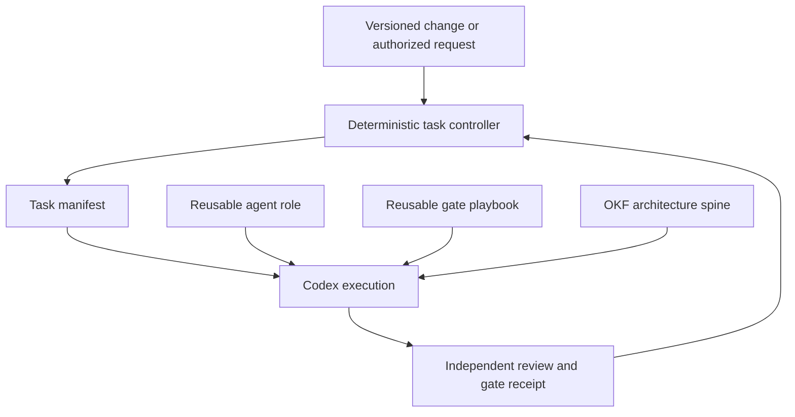

# Reusable agent workflows in Progressive Concretization

Status: **design contract**, not yet an implemented generic dispatcher.

## Purpose

Do not write a new full-length agent prompt for each AS, AP, experiment, or gate.
A role defines the specialist's permanent behavior. A playbook defines a reusable
operation. A task manifest identifies the current job. The architecture spine
supplies task-specific knowledge.

A prompt such as `prompts/17-ae004-post-vo001.md` is a **pilot-specific
task ticket**, not the intended interface for future projects.

## Four authorities

1. **Role** (`agents/<role>.md`): responsibility, allowed writes, forbidden
   actions, and the form of a valid completion.
2. **Playbook** (`process/playbooks/<operation>.md`, proposed): reusable
   step sequence, evidence checks, gate conditions, and expected output kinds.
3. **Task manifest** (`process/tasks/<task-id>.yaml`, proposed):
   architecture spine, operation, trigger, input revisions, output scope,
   reviewer and acceptance gate. The manifest is *data*, not a custom prompt.
4. **Knowledge and policy** (OKF spine, accepted decisions, AS, F, VO/AD
   ledgers, proof receipts, and stage-gate policy): what is actually binding.

`prompts/generic-task.md` is the reusable agent entry point. It delegates
to these authorities instead of embedding an ADC-specific task description.

## Intended dispatch

The controller determines **what** needs review and **when** it is eligible.
Codex determines **how** to analyze the domain facts within its assigned
responsibilities. No LLM may grant its own engineering authority.

## Reusable operation names

- `CURATE_EVIDENCE`: Index new BKP evidence; preserve provenance.
- `BUILD_AS`: Prepare or revise C, R, PS with authority traceability.
- `DISCOVER_PROOF`: Identify useful proof opportunities.
- `DEVELOP_PROOF`: Investigate an accepted PO.
- `REVIEW_PROOF`: Independently assess theorems and counterexamples.
- `PROPOSE_AP`: Generate competing architectures.
- `EVALUATE_AP`: Check AP-due evidence and rank admissible proposals by F.
- `PLAN_EVIDENCE`: Find least-cost evidence for outstanding obligations.
- `REVIEW_VO`: Independently discharge or retain one verification obligation.
- `SELECT_AP`: Prepare a recommendation; only separate authority may commit.
- `DEFINE_CON`: Create interface and behavior contracts.
- `DECOMPOSE_DE`: Refine selected AP into independently implementable elements.
- `IMPLEMENT_DE`: Implement approved contracts and designs.
- `VERIFY_IMPLEMENTATION`: Assess implementation and target evidence.

The role and playbook must not hardcode AS numbers, particular memory limits,
specific hardware, or artifact filenames. Task-specific references belong in
the manifest and spine.

## Minimal task-manifest semantics

A task manifest must identify:

- Stable task ID and `schema` version.
- Selected role and operation.
- Root architecture spine (never inferred from a particular toy case).
- Triggering artifact or gate, with version/hash when important.
- Permitted read relationships and mandatory dependency closure.
- Allowed output artifact types and prohibited upstream mutations.
- Required gate, receipt type, and review independence.
- Behavior on missing evidence: `UNRESOLVED`, never fabricated `PASS`.

See `process/examples/task-manifest-v1.yaml` for an *illustrative* template.

## General procedure for a reusable evaluation

1. Resolve task manifest and the current Git revision.
2. Follow the task's spine and role-specific relationship policy.
3. Read AS, F, stage policy, applicable proof receipts and current VO/AD ledger.
4. Determine which obligations became due or changed since last evaluation.
5. Create **new versioned** assessments; preserve prior decisions unchanged.
6. Attempt the smallest credible evidence resolution before escalating work.
7. Evaluate stage eligibility with a deterministic gate tool.
8. Record outstanding assumptions, VOs and proposed AD, without accepting
   debt or selecting an architecture on the agent's own authority.
9. Write a bounded review receipt listing source revisions and checks.

This sequence must work for a battery estimator, scheduler, ADC detector, or
any other architecture that supplies compatible AS/F/policy artifacts.

## Current pilot limitations (do not misrepresent as completed)

At the current pilot revision:

- `tools/telemetry.py` hardcodes
  `/architecture/AS-001/spine.md` in the context-profile and export paths.
- `tools/stage_gate.py` is tailored to C-002's memory envelope and the
  six toy-case obligations, rather than loading a fully generic requirement
  registry and typed acceptance checks.
- Several role descriptions and prompts refer to AS-001 and specific
  artifact paths. Task manifests are not consumed by the runner.
- `process/workflow.yaml` describes transitions but does not dispatch them.

The design contract is therefore **forward-looking**. Existing numbered
prompts remain valid for reproducing historical runs. Do not silently change
them or replace a current gate while its evaluation is in progress.

## Recommended migration

**Phase 1:** Stabilize generic role and playbook schemas; document the
task-manifest contract and use `prompts/generic-task.md`.

**Phase 2:** Parameterize telemetry and spine traversal by task manifest
instead of the AS-001 constant. Track which mandatory dependencies were
included or intentionally deferred.

**Phase 3:** Parameterize stage-gate evaluation using a requirement registry,
verification due stages, domain-specific validators, and receipt references.
Keep project-specific numerical checks as plugins, not universal rules.

**Phase 4:** Add a deterministic `next-task` planner using changed artifacts,
accepted receipts, and workflow rules. Require separate authority for
protected decisions.

## Migration acceptance tests

1. Two distinct architecture spines use the same evaluation role and
   playbook without modifying their text.
2. Each run loads only its own scoped graph; neither includes the other
   project's artifacts.
3. A due VO without an accepted receipt blocks progression.
4. A future-due VO can advance only with a complete verification plan.
5. No architecture is selected solely because structural tests pass.
6. Old evaluation results remain immutable across all reassessments.

**Guiding rule:** We should write a new *task manifest* when an obligation
changes, not a new *agent prompt*. The eventually automated controller should
generate most manifests directly from the graph.
