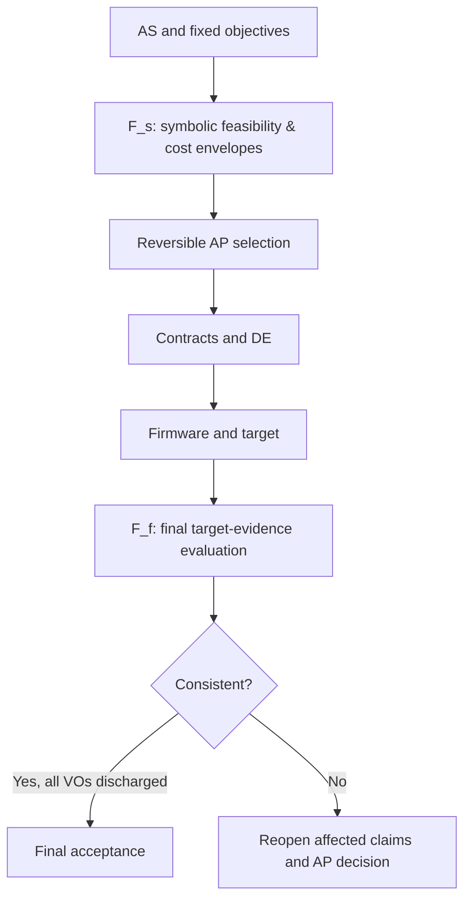

# Symbolic and final Figures of Merit

**Status:** PROPOSED methodology refinement, pending separate process review.
**Affected authority:** Existing F-001 remains unchanged.
**Decision history:** Engineering authority proposed an `F_s` pre-implementation
symbolic quantity and `F_f` final measured quantity at the time of the
approved AP-002 CON-first commitment.

## 1. Why the distinction matters

An AP is selected before its implementation exists. Demanding final target
costs to choose an AP makes contract-first decomposition circular. Yet
accepting a proposal with no cost reasoning makes F a formality.

We therefore propose **two evidence maturities of the *same* figure of merit**:



A proposed stage split changes the **type and maturity of evidence**, not
the objective weights, hard constraints or protected stakeholder decisions.

## 2. Definitions

Let `a` denote a candidate architecture and `θ` the declared problem
parameters, representation decisions, toolchain properties and uncertainties.

`F_s(a; θ)` is a *vector of expressions, intervals and evidence types* for
the original objectives. It may include:

- Algebraic or worst-case memory-allocation expressions.
- Operation counts and symbolic cost models whose coefficients are explicit.
- Bounds on time or energy conditional on execution assumptions.
- Flash-code-size estimates only when the model and its uncertainty are
  defined; otherwise `UNKNOWN`.

`F_f(i; h, w)` evaluates implementation `i`, hardware/toolchain `h`,
and declared workloads/interrupt environments `w`. It may contain measured
memory/flash use, target cycle measurements, statically justified WCET bounds,
and accepted mapping and correctness evidence.

`F_f` is **not** equivalent to taking an average benchmark. Hard timing
requirements need a conservative worst-case claim supported by an appropriate
method; finite empirical testing alone cannot establish a universal bound.

The two vectors must have the same objective axes and units. A component
with no trustworthy symbolic bound remains `UNKNOWN`, never zero or PASS.

## 3. Toy 1 symbolic examples (illustrative; not accepted ranking)

For `N` samples, the recomputing AP has a bounded inner loop with
approximately `N` squaring operations per update. An incremental ring
approach uses two squarings and constant additional bookkeeping per update.

A symbolic compute cost can retain unknown target costs explicitly:

```text
C_s(recompute; N) = N*(c_load + c_mul + c_add) + c_loop(N)
C_s(incremental)  = 2*c_mul + c_load_old + c_load_new
                    + c_sub + c_add + c_store + c_index
```

The expressions provide an operational tradeoff, but **not** a numerical
cycle/Pareto result until the coefficients are justified.

Both candidates have conditional 72-byte *state* allocations in the current
v3 assessments. The 2048-byte C-002 limit instead applies to **total
detector-attributable SRAM** under Option B. Keep these two accounting
quantities distinct.

Compiled flash remains `UNKNOWN` at this stage. We cannot assert an
unconditional F_s Pareto winner or completed F_f verification.

## 4. Symbolic comparison and change tracking

When costs are uncertain, use an admissible **partial order** rather than
inventing weights. A statement that `a` robustly dominates `b` is justified
only when the accepted bounds show no worse cost on each axis for the
declared domain and strict improvement on at least one axis.

After implementation, record a correspondence for each component:

```text
F_s objective -> bound/assumption -> contract -> DE -> target evidence -> F_f
```

If a measured or proven final cost contradicts a material F_s prediction,
invalidate the affected projection and reassess the provisional selection.
That is an Architectural Debt/verification event, not permission to quietly
retune F after seeing results.

## 5. Scope and approval

This document does **not** amend F-001, change AP-002 selection conditions,
add an accepted theorem, discharge a VO, or claim performance on a target.

A future approved model should supply reusable output schemas for symbolic
expressions, dimension units, uncertainty and evidence quality, and measured
or bounded final costs. The toy-specific validation logic belongs in
separate project adapters.

In particular, F_s may support **earlier justified architectural selection**
while F_f remains binding for **final acceptance**.
