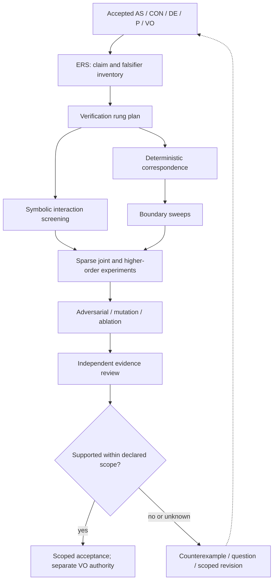
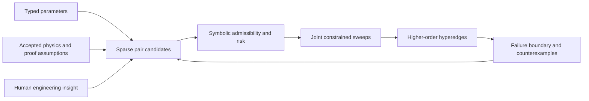

# Theory of Verification
## Evidence-Accumulating Rungs and Symbolic Interaction Hypergraphs

**Status:** Proposed generic process architecture v0.1, 2026-10-14. Not yet implemented or accepted as a process gate.
**Companion:** [Verification Framework Requirements](VERIFICATION_FRAMEWORK_REQUIREMENTS.md).
**Inspiration:** The user-supplied `ENGINEERING_REQUIREMENTS_SPEC_v0.10.0(1).md` and `VERIFICATION_PLAN_v0.10.0(1)(1).md`. These are instructional battery-estimator examples, not authorized requirements for Toy 1 or Archbot. They have not been imported into this repository.

## 1. Verification is not construction

Progressive Concretization develops firmware from BKP, AS, proofs, F, AP, CON and DE. A successfully generated implementation is not proof that the resulting system works within the intended application. Verification starts from **claims and possible falsifiers**, not from whatever tests happen to be available.

The supplied examples distinguish what the algorithm claims, what it may observe, which conditions are admissible, and what evidence could disprove the claim. They introduce deterministic sanity, one-factor sweeps, population, adversarial search, ablation and calibration. These are examples of **themes**, not six mandatory rungs for every project. An exact integer algorithm need not invent a statistical uncertainty output to fit a calibration rung.

A verification result must distinguish mathematical proof, implementation correspondence, empirical evidence, and physical/target qualification. Evidence for one does not automatically establish the others.

## 2. Two proposed post-implementation stages

**DERIVE_ERS** creates an independently reviewed Engineering Requirements Specification **for verification**. It projects existing accepted AS/CON/DE, proof assumptions, implementation, BKP, open VOs, accepted decisions and their provenance into explicit claims, domains, evidence boundaries, falsifiers, acceptance criteria and non-claims. The ERS is **not a second product-requirements authority**. Novel requirements are proposals requiring existing authority procedures.

**DESIGN_VERIFICATION_LADDER** creates an independently reviewed, claim-directed set of rungs with evidence dependencies, admissible experiments, symbolic analyses, oracles, artifacts, costs and stopping conditions. Later, **EXECUTE_VERIFICATION_LADDER** can execute those rungs and record independently reviewed evidence. Execution is a planned operation, not part of the current documentation-only change.

## 3. Evidence accumulates, but confidence can decrease

A rung produces a **claim-indexed evidence increment**, not just PASS/FAIL: claim ID, authority, domain, assumptions, predecessor receipts, independent oracle, symbolic bounds, observed results, counterexamples, residual unknowns, reproducibility manifest and next-rung rationale.

Rungs form an evidence-dependency **DAG**, not a compulsory fixed linear ladder. Independent rungs may run in parallel. Later rungs inherit accepted facts and recorded failures, and use them to select the next experiment. A counterexample can narrow or overturn an earlier conclusion; preserve the historical receipt and explicitly supersede its scope.

Proposed rung outcomes are SUPPORTED_WITHIN_SCOPE, CONTRADICTED, UNRESOLVED, NOT_APPLICABLE and NOT_EVALUATED. These do not replace the authoritative VO ledger's statuses.

## 4. Reusable verification themes

| Theme | Question |
|---|---|
| Correspondence | Does the implementation preserve the accepted equations and interfaces? |
| Boundary | Where do legal extremes, transitions and mode changes fail? |
| Interaction | Which jointly legal conditions fail despite passing independent sweeps? |
| Adversarial | Can a constrained search find an admissible counterexample? |
| Necessity | Does a design feature earn its complexity? |
| Verifier effectiveness | Do tests catch deliberately introduced faults? |
| Population/calibration | Do statistical claims survive variation, and is uncertainty calibrated? |
| Platform/integration | Do actual target arithmetic, SRAM, stack, timing and ownership constraints hold? |
| Synthesis | Which claims are supported, contradicted or still open, and within what scope? |

**Ablation** removes or restricts features to measure their necessity. **Mutation** introduces deliberate defects to evaluate the verifier. Surviving equivalent mutants are classified, not blindly treated as test failures. Probabilistic rungs are NOT_APPLICABLE unless a claim warrants them.

## 5. Sparse interaction matrix and hypergraph

Let parameters `P={p1,...,pn}` have declared type, units, legal range, operating mode, provenance and ownership before interaction evaluation. The square matrix `M[i,j]` indexes **candidate interactions**, not necessarily statistical covariance. Store it sparsely as typed edges with coupling mechanism, admissibility, risk, uncertainty, test cost and evidence references. Absence of an edge means *not yet modeled*, never proved independent.

Promote high-risk pairs into hyperedges `e={pi,pj,...,pk}` when shared state, conservation laws, counterexamples, proof assumptions or human insight suggest a higher-order failure. Search the admissible region, not the full Cartesian product by default. Parameter covariance can inform realistic likelihood; a deterministic failure may still matter even when covariance is zero.

### 5.1 Symbolically evaluate hyperedges before expensive sweeps

For each candidate edge, construct a symbolic model relating joint inputs to the failure predicate. Check:

1. **Dimensions and types:** units, scaling, bit widths, quantization, signedness and conversions.
2. **Polarity and sign:** amplification, cancellation, monotonicity, feedback, direction conventions.
3. **Magnitude and scale:** interval/affine bounds, overflow, saturation, conditioning, resource peaks.
4. **Temporal coupling:** burst arrival, service latency, queue occupancy, state persistence and overlapping execution.
5. **Feasibility:** reachable states, mutually exclusive modes, protocol and physical constraints.
6. **Higher-order interactions:** mixed derivatives for smooth models; piecewise, interval, SMT or boundary search for discontinuities.

Mixed sensitivity `d²J/(dpi dpj)` can *suggest* coupling but cannot alone prove a failure. A threshold may be invisible to local derivatives. Symbolic outcomes: PROVED_SAFE_WITHIN_DOMAIN, SAT_COUNTEREXAMPLE, INFEASIBLE_COMBINATION, INCONCLUSIVE, or MODEL_INVALID. Every outcome carries assumptions, solver/method provenance, bounds or witness, and scope. A satisfiable symbolic witness is not necessarily physically realizable without validated model assumptions.

### 5.2 UART example: big AND fast

For message length `L` bytes, message rate `f` messages/s, consumer rate `mu` bytes/s and occupancy `B`, the simplified fluid model gives `lambda=L*f` and `dB/dt=lambda-mu`. If `L=240`, `f=100/s`, and `mu=12000 B/s`, offered load is `24000 B/s` and backlog grows at `12000 B/s`. With 256 bytes free, a fluid approximation reaches that capacity in about 21.3 ms. **These numbers are illustrative, not UART product requirements or measurements.**

For bursty traffic use valid arrival and service envelopes `alpha(t)` and `beta(t)`; required backlog is bounded by `sup(t>=0)[alpha(t)-beta(t)]` under the envelope assumptions. A credible edge might be `{message_size, message_rate, service_latency, available_buffer}`. Individual sweeps can pass while this combination violates the buffer claim. Conversely, an approved protocol may forbid large and fast messages from co-occurring; only **authorized, evidenced** constraints may exclude that corner.

### 5.3 Toy 1 example without invented requirements

Candidate symbolic edges for the exact newest-32 squared-sum detector include `{sample_magnitude, accumulator_width, expression_order}`, `{ring_index, startup/reset_state, eviction}`, and `{integer_promotion, compiler_target}`. The accepted abstract theorem constrains the mathematical sum; verification must separately establish C expression behavior and target/integration claims. **Do not reintroduce a 1-ms cadence, loss watchdog or unapproved ISR/concurrency contract just to populate the matrix.**

## 6. Selecting and stopping rungs

Start with proof assumptions and deterministic cases, then evaluate boundaries and symbolic couplings. Promote promising pairs into constrained sweeps and higher-order search. Prefer failure-surface discovery and minimized replayable counterexamples to blind high-volume random testing. Record every test's admissible domain, oracle, seeds, tools, input hashes, output hashes and limitations.

A rung can stop when its scoped claim is adequately supported, a counterexample disproves it, it is demonstrably inapplicable, or an approved cost/time limit is reached. **Budget exhaustion is not success.** An unresolved human question pauses only affected work.

Every rung generates a compact **Engineering Briefing**: what was established, what changed in understanding, what failed, which assumptions remain and why the next experiment is useful. The briefing, question and evidence are project-spine-linked and archiveable offline; an interactive UI is not yet required.

## 7. Authority, independence and acceptance

Verification may reveal new candidate BKP facts, assumptions, proof opportunities, design risks and possible requirements. None becomes a binding AS/CON requirement or a discharged VO without its existing controlled authority path. Independent review checks both test design and results. A passing host test does not prove target memory, stack or publisher continuity.

The assurance chain is `accepted claim -> scoped assumptions -> proof/CON/DE -> implementation -> rung receipts -> independent verdict`. Changes to an assumption trigger scoped impact analysis; keep superseded receipts and non-claims.

## 8. Installation boundary

This document specifies a **future generic process**, not an executed verification ladder. The next development task is to define generic `DERIVE_ERS`, independent ERS review, `DESIGN_VERIFICATION_LADDER`, independent plan review, and eventual rung execution with a sparse symbolic interaction model. Apply to Toy 1 without inheriting battery-specific thresholds from the instructional references. Then test generality in the planned cleanroom Toy 1 and Toy 2 campaigns.

## 9. Worked adversarial design study: VS-001

[VS-001: worked three-stage examples and adversarial findings](VERIFICATION_DESIGN_STUDY_VS001.md) tests the proposal using exact rolling arithmetic, coupled queue demand and statistical calibration. It records seven design/review rounds, explicit counterexamples, bounded mathematical probe results, and an adversarial coverage ledger.

The study proposes sharper semantics before generic implementation: normative ERS extraction separate from code observations; bidirectional source coverage; quantifiers, horizons and nonvacuity; reachable-state and approximation-direction checks; higher-order edges that do not require a failing pair; separate scheduling and proof-premise relationships; statistical sampling/selection identity; and full subject/model/oracle/build fingerprints.

A valid conditional model theorem can be accepted under its stated assumptions even while product correspondence remains open. What must be refused is an unjustified promotion to product safety. These are proposed refinements of v0.1, not changes to product authority or current VOs.

The study recommends one narrow vertical slice across ERS, planning and execution, centered on a small typed evidence checker. It is self-adversarial design work, not an independent verification of Archbot or a completed cleanroom qualification. The live runner and installed operations are unchanged by this documentation update.
