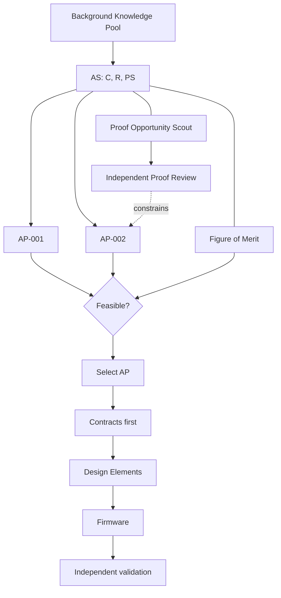
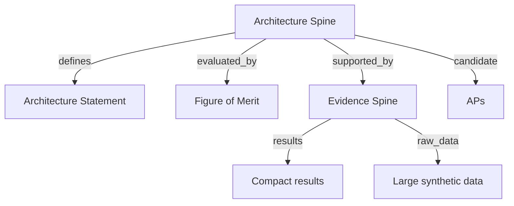

# Progressive Concretization: minimal operating model

The starter exercises the earliest part of this process; later artifact types have templates but no approved instances. We do not create firmware or contracts before AP selection.

## Spine projection

The `proof-scout` view follows `results` but not `raw_data`. The `experimental-investigator` view can enumerate the raw data. Either may make an explicit justified request for missing evidence. Context restriction is **not** proof, nor access control.

## Gates

- Evidence traceability: sources, provenance, and missing assumptions noted.
- AS: C, R, and PS consistent or marked unresolved.
- PO: conjecture recognized as such; no fake verification.
- Proof: independently checked conditional theorem, with exact assumptions.
- AP: hard obligations first, predeclared F second.
- CON/DE: externally observable contracts fixed before each DE internal design.
- Firmware: conformance and memory/cycle evidence on target.

`tools/pc.py check` certifies none of these semantic gates. It only checks structural properties of this small bundle.
