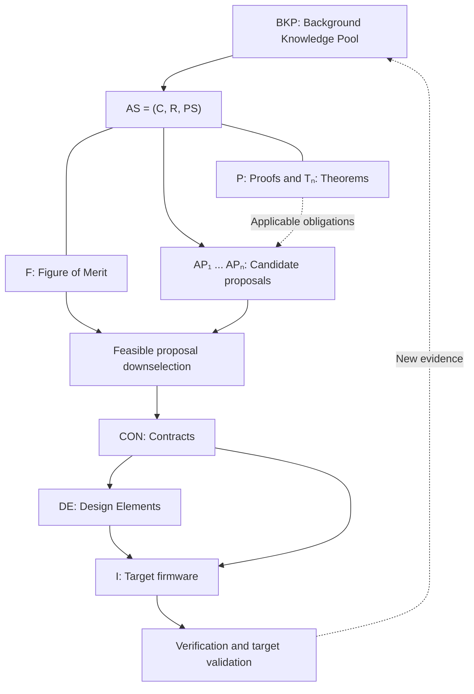
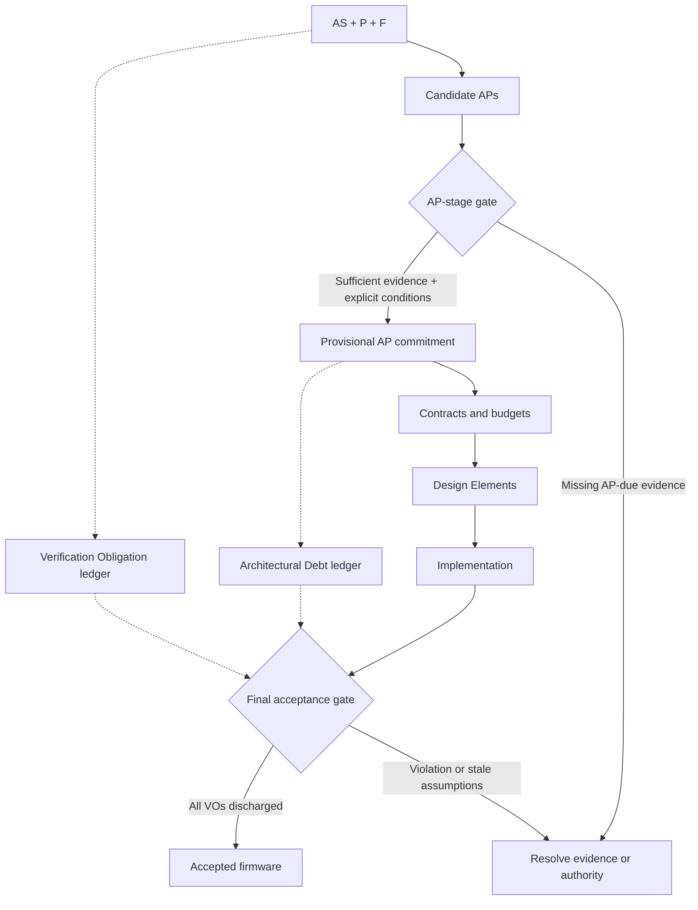
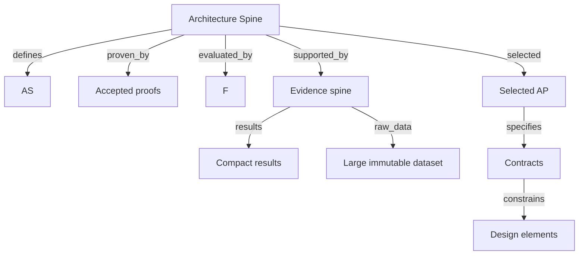

# Progressive Concretization
## Theory of Operation

**Status:** Architectural concept and process definition  
**Purpose:** Orient engineers, reviewers, and AI agents before they modify architecture artifacts or firmware.  
**Scope:** The architectural principles developed before the initial Codex prototype. This document is intentionally not an implementation or experiment log.

## 1. Executive overview

**Progressive Concretization** is an evidence-traceable, proof-aware process for transforming an engineering problem into firmware. It begins with background knowledge and ends with a target-specific implementation. Each transition makes the design more specific while preserving applicable obligations established upstream.

The architectural deliverable is more than firmware: it is **firmware plus an inspectable chain of justification**. A reader should be able to trace an implementation decision backward to the requirement, constraint, architectural choice, theorem, or evidence that motivated it. Conversely, a changed input assumption should reveal which downstream artifacts require review.

The **Progressive Verification Principle** is equally fundamental: a requirement stays binding at every stage, but the evidence required to advance matures as a design becomes concrete. An uncompleted verification may be deferred only through an explicit, tracked obligation with a due stage and discharge plan.

The process deliberately separates three questions:

1. **What must be true?** The Architecture Statement (**AS**).
2. **What can be established mathematically?** Proofs (**P**) and theorems (**Tₙ**).
3. **Which feasible approach is preferable?** The Figure of Merit (**F**).

No one artifact is permitted to silently redefine the authority of another. Proofs do not replace requirements; optimization does not excuse violations of hard requirements; passing tests does not by itself constitute a mathematical proof.

## 2. Conceptual architecture



The principal progression is **knowledge → obligations → proposals → provisionally selected architecture → contracts → component designs → firmware → final acceptance**. Proof discovery, independent verification, and evidence updates may occur throughout the progression.

### 2.1 Architectural objects

| Symbol | Artifact | Core question |
|---|---|---|
| **BKP** | Background Knowledge Pool | What do we know, from what source, with what uncertainty? |
| **C** | Constraints | What boundaries are non-negotiable? |
| **R** | Requirements | What must the system demonstrably do? |
| **PS** | Problem Statement | What problem is being solved, and why? |
| **AS** | Architecture Statement, `AS = (C, R, PS)` | What obligations must any solution satisfy? |
| **POₙ** | Proof Opportunity | Which useful mathematical claim might be provable? |
| **P** | Proof package | Under what assumptions has a theorem actually been established? |
| **Tₙ** | Theorem | What precise mathematical proposition is asserted? |
| **F** | Figure of Merit | How are feasible solutions compared and downselected? |
| **APₙ** | Architectural Proposal | Which structure could satisfy AS? |
| **CON** | Contract | What must components guarantee at their boundaries? |
| **DE** | Design Element | What independently implementable element fulfills part of the architecture? |
| **I** | Implementation | How is the design realized on the target hardware? |

All significant objects should have stable identifiers, versioned content, explicit status, and traceable dependencies. The BKP may contain physical observations, specifications, measurements, stakeholder decisions, assumptions, counterexamples, and citations. A requirement's origin may be a decision or business objective rather than a scientific deduction; its authority must still be traceable.

## 3. The two laws of concretization

### 3.1 Progressive commitment

As the process advances, **design freedom decreases and specificity increases**. The AS defines admissible outcomes without choosing an algorithm. Candidate APs offer alternatives. Selection commits to a structural approach. Contracts commit to boundaries and invariants. DEs commit to internal designs. Firmware commits to representations, allocation, arithmetic, and execution behavior.

Commitments should be delayed until justified. The process need not be a one-way waterfall: later discoveries may require revisiting an earlier decision. Such revisions must be explicit and trigger review of affected descendants.

### 3.2 Preservation of obligations

Every accepted downstream artifact must preserve its applicable upstream obligations. **Deferred verification is not deferred compliance**: accepting a design stage does not waive the final requirement. Refinement is not permission to quietly weaken or discard a requirement, theorem assumption, or interface guarantee.

Conceptually:

```text
BKP justification
   → AS obligations
   → AP claims and supporting evidence
   → CON guarantees and DE responsibilities
   → Implementation properties
   → Validation evidence
```

The actual assurance argument is **conditional**. A theorem is of the form `Aₙ ⇒ Tₙ`, where `Aₙ` states its assumptions. A proof about an abstract accumulator is relevant to firmware only if the chosen architecture and concrete implementation satisfy the assumptions under which the theorem holds. Similarly, a passing simulation is evidence within its tested domain, not automatically a universal guarantee.

## 4. Three parallel architectural authorities: AS, P, and F

**AS** specifies what must be accomplished. **P** establishes mathematical facts and boundaries that constrain how AS can be satisfied. **F** ranks solutions that are already feasible.

An AP must satisfy all obligations **due at the AP stage** and provide credible, documented plans for obligations whose final verification is due later. Only stage-admissible APs may be compared using F. A conditional estimate is not a final proof of compliance. Define F *before* assessing candidates to avoid fitting the metric to a favored design.

F may consider RAM, flash, worst-case execution time, energy, latency, complexity, robustness, and verification cost. Resource tradeoffs may require a Pareto analysis rather than a single weighted score. Asymptotic complexity and actual target costs are distinct: a lower-big-O algorithm is not necessarily cheaper for the finite problem size at hand.

A proof may establish a bound, invariant, impossibility result, identifiability condition, or composition guarantee. An impossibility theorem can be especially valuable because it can prevent the team from investing in an infeasible AP.

### 4.1 Proposed staged Figures of Merit: `F_s` and `F_f`

A proposed refinement separates **symbolic pre-implementation comparison**
(`F_s`) from **final target-evidence quantification** (`F_f`). Both
describe the *same protected optimization objectives* at different evidence
maturities. The symbolic form retains parameterized resource expressions,
formal or conditional bounds, and explicit unknowns. The final form uses
measured footprint, justified worst-case resource bounds, and accepted
implementation/target evidence.

The transition from `F_s` to `F_f` must be traceable through assumptions,
CON and DE. Unexpected discrepancies reopen affected decisions rather than
causing silent adjustment of the figure of merit. An incomplete `F_s`
comparison can support only a **separately authorized, reversible** AP
selection with Architectural Debt; it does not establish a final Pareto winner.

**Authority note:** This is a proposed method in
`docs/STAGED_FIGURE_OF_MERIT.md` and
`process/proposals/F_STAGES_001.yaml`. It does **not** amend the accepted
F-001 or change existing architecture approval conditions without a
separate protected process decision.

## 5. Proof discovery and Proof Opportunities

Formal proofs should not depend on a gifted contributor happening to volunteer one. A **Proof Scout** examines the BKP, AS, candidate APs, contracts, and designs for high-value mathematical statements worth investigating.

A **Proof Opportunity (POₙ)** is a conjecture and research request, **not an accepted theorem**. It should state:

- Proposed claim and explicit assumptions.
- Links to motivating AS clauses and BKP sources.
- Expected architectural benefit, such as reducing memory, compute, uncertainty, or risk.
- Candidate proof strategy and missing information.
- Current status: proposed, investigating, verified, refuted, or deferred.

The Proof Engineer develops a rigorous argument or counterexample. An independent reviewer challenges assumptions, derivations, and claimed scope. Only accepted results are promoted to proof authority. Retain rejected opportunities and counterexamples when they teach us something about the design space.

Proof discovery works in both directions: **forward**, asking what the known facts permit us to prove; and **backward**, asking which theorem would remove an expensive or risky architectural decision.

### 5.1 Illustrative case: accumulator width

For 32 unsigned 12-bit samples, a sliding sum of squares obeys

\[
0 \le S \le 32(2^{12}-1)^2 = 536{,}608{,}800 < 2^{29}.
\]

This establishes that a 32-bit unsigned accumulator can represent the exact mathematical sum. A separate invariant proof is needed for a rolling update such as `S_next = S - oldest² + newest²`, including initialization and wraparound. Additional implementation obligations concern intermediate widths, C integer promotions, index handling, and target execution time. The example demonstrates how a proof can *inform* architecture while remaining distinct from verified firmware behavior.

## 5.2 Progressive Verification and Verification Obligations

An architecture may not be fully verifiable until it has contracts, complete data layouts, a compiler output, or target measurements. Demanding implementation-level proof at AP selection creates a cycle: no AP can be selected without code, but CON and DE cannot be established without an AP. **The correct solution is to schedule verification, not weaken requirements.**

Each AS requirement declares at least:

- `first_assessable_at`: earliest meaningful assessment (for example, an analytical lower bound at AP).
- `verification_due_at`: latest stage at which adequate final evidence must exist.
- `verification_plan`: evidence expected at AP, CON, DE, implementation, and target validation as applicable.
- `scope`: the measured boundary (for example, whether the 2 KiB includes state, stack, and shared services).
- `authority`: the BKP source or decision justifying the requirement.

A **Verification Obligation (VO)** tracks any requirement not finally discharged. The VO names the requirement, present state, assumptions, next action, evidence owner, final due stage, acceptance criterion, and escalation path if it fails. VOs travel with the selected AP through CON, DE, and firmware. A Proof Scout may propose a PO that discharges a VO earlier, but PO and VO are distinct: the former asks whether a theorem is useful, the latter records what **must** be verified.

### Gate classification

| State | Interpretation | Can advance? |
|---|---|---|
| `SATISFIED` | Required evidence at this stage is accepted | Yes |
| `CONDITIONALLY_SATISFIED` | Stage evidence holds under explicit, tracked assumptions | Yes, if the current gate permits it |
| `DEFERRED` | Final verification belongs to a later stage, with a credible plan and owner | Yes, if no evidence is due now |
| `UNRESOLVED` | Evidence required **now** is absent or the deferral plan is inadequate | No |
| `VIOLATED` | Evidence contradicts a hard requirement | No |

Selection is **provisional with respect to future VOs**, not an assertion that final hardware compliance has already been demonstrated. Deferral past the point at which correction becomes prohibitively expensive requires explicit risk acceptance. A failed later check triggers scoped impact analysis: first reconsider implementation, then DE/CON, then AP, with every invalidated gate recorded.

### Example: 2 KiB SRAM

- **AS:** State and memory accounting boundary are defined; limit remains 2048 bytes.
- **AP:** A conservative resource model and plausible margins are provided; exact linker usage is not falsely claimed.
- **CON:** Each interface and owner receives an explicit memory budget.
- **DE:** Concrete buffers, states, alignment, and stack contributions are bounded.
- **Implementation:** Static/map analysis establishes allocated bytes and stack bounds; runtime validation addresses any dynamic assumptions.

A 32-entry `uint16_t` sample buffer contributes 64 bytes; a `uint32_t` sum contributes four more. This is useful partial evidence, **not** a final 2 KiB subsystem proof. A requirement may be marked `DEFERRED` at AP only if the relevant AP-stage resource estimate passes its own gate and the remaining verification is explicitly scheduled.

The AS, F, and prior evaluations remain immutable historical evidence: when gate semantics change, produce a new evaluation (for example, AE-002) rather than rewriting AE-001's `NO_DOWNSELECTION` conclusion. F retains its predeclared criteria and hard final constraints; the gate clarifies which stage-appropriate evidence permits a **provisional** ranking.

## 5.3 Provisional architectural commitment, final acceptance, and Architectural Debt

**Commitment precedes complete verification.** A candidate AP may be selected **provisionally** for CON-first decomposition when all evidence due at the AP gate is adequate and all later obligations have owned, credible discharge plans. It is not declared finally compliant or the final F winner. When mandatory AP-stage evidence is missing, selection remains blocked; the process must not demand a linker map from an AP that has not yet been decomposed.

**Verification Obligations (VO)** describe *what must be demonstrated* and when. **Architectural Debt (AD)** describes *decision risk voluntarily accepted before complete knowledge*. Examples: VO: demonstrate worst-case deadline compliance; AD: selecting a promising AP before target cycle comparisons are available. Recording AD never discharges a VO. Each accepted AD must name its initiating decision and assumptions, owner, exposure if false, resolution deadline, fallback, and authority accepting the risk. A critical missing requirement interpretation is a **blocker**, not ordinary debt that an LLM can silently accept.



An **authoritative VO ledger** records current open/discharged verification state, grounded in accepted review receipts. Individual VO documents define the obligations and historical revisions; they must not become conflicting authorities for current state. An **AD ledger** separately records accepted decision risks and unresolved blockers. A provisional AP decision must transfer all outstanding VO and accepted AD records to CON and DE handoffs. Debt cannot be accepted by the same agent that proposed it.

A versioned **AP-stage selection policy** supplements, but must not silently rewrite, F. For example, F-001's final objective remains the Pareto frontier of state SRAM, worst-case cycles/update and flash bytes after complete hard-feasibility verification. Stage selection may instead assess architectural resource envelopes and projected operating cost, if an authorized stage policy permits such evidence. An unknown flash or cycle metric must never be reported as a measured value. If no projected candidate dominates, a provisional tradeoff needs explicit stakeholder authority and a debt record.

**Requirement scope is part of the obligation.** For example, AS-001 states that *detector state* shall fit 2 KiB; it does not automatically establish that interrupt context and unrelated shared services are included. The responsible stakeholder must authorize that boundary. Until then, C-002 is an unresolved AP-stage authority decision, not a failure of a plausible 72–76 B algorithm-state estimate. Scope decisions must be linked to the existing AS or versioned as changes. Final verification retains the original hard limit with its approved accounting boundary.

### Two gate decisions, not one

| Gate | Commitment | Permitted outstanding work |
|---|---|---|
| Provisional AP selection | Authorize CON-first decomposition from a feasible AP family with credible assumptions | Final implementation/target VOs, plus explicitly accepted architectural decision risk |
| Final implementation/target acceptance | Establish concrete compliance with all binding requirements | No unresolved binding VO; any remaining noncompliance risk requires an explicit separate policy rather than silent PASS |

A failing later-stage VO reopens the smallest relevant decision (I, DE, CON, AP, or even AS authority) and invalidates dependent gate receipts. Previously recorded evaluation decisions remain historical, not overwritten. Every stage must distinguish a process-check PASS from an independently accepted engineering conclusion.

## 6. Contract-first decomposition

After choosing an AP, derive **contracts (CON)** from the selected architecture before designing the internals of individual **design elements (DE)**. A contract defines the inputs, outputs, data representation where required, temporal behavior, ownership, preconditions, postconditions, invariants, and error handling at a boundary.

This ordering permits independent development: multiple engineers or agents can implement DEs without quietly inventing incompatible interfaces. Each DE must satisfy its assigned contracts; the integration must also establish that the contracts compose correctly. Component-level correctness does not guarantee system-level correctness without compatible timing, state, resource ownership, and assumptions.

The implementation specialist receives approved DE specifications, CONs, target constraints, and applicable proof obligations. The implementation is evaluated for correctness and resource use, aiming for the lowest practical memory and compute cost **among implementations preserving the required guarantees**.

## 7. Verification gates

| Gate | Question | Required outcome |
|---|---|---|
| **G0 Evidence** | Is the relevant BKP identifiable and trustworthy enough? | Provenance, assumptions, and known gaps recorded |
| **G1 Statement** | Are C, R, and PS coherent and traceable? | Reviewed AS; conflicts or uncertainties explicit |
| **G2 Proof** | Are useful mathematical guarantees available? | Reviewed P where applicable; absence is explicit, not disguised as failure |
| **G3 AP provisional commitment** | Which AP passes AP-due evidence, and what future conditions remain? | Provisional decision, VO/AD carry-forward, stage-authorized tradeoff if needed |
| **G4 Decomposition** | Do contracts and DE responsibilities faithfully refine the selected AP? | Reviewed boundary guarantees and composition obligations |
| **G5 Implementation** | Does code satisfy DE and CON? | Tests, analysis, and resource evidence |
| **G6 Final target acceptance** | Does real target behavior satisfy AS, and have all binding VOs been discharged? | Independent evidence and final F ranking; no silent final deferrals |

A gate records one of **PASS**, **FAIL**, or **UNRESOLVED** (with richer dispositions where useful). An LLM's confidence or its ability to produce polished documentation cannot substitute for a reproducible check or independent acceptance. No agent approves its own work.

## 8. Knowledge representation: OKF and typed links

Use Google's **Open Knowledge Format (OKF) v0.2** as a Markdown-oriented, Git-friendly knowledge substrate. Concepts are readable documents with YAML frontmatter, links, and source/provenance information. An OKF bundle is not itself a graph database or a proof checker: graph traversal and validity checking are provided by our tools.

Project-specific fields may represent typed relationships, for example:

```yaml
---
type: ArchitecturalProposal
id: AP-002
relations:
  - kind: addresses
    target: /architecture/AS-001.md
  - kind: evaluated_by
    target: /merit/F-001.md
  - kind: decomposes_into
    target: /design/DE-001.md
---
```

The `relations` vocabulary and schema shown here are **local conventions**, not claims of standard OKF fields. Distinguish `supported_by` (empirical or documentary evidence), `assumes` (conditions), `proven_by` (accepted formal justification), `evaluated_by` (a criterion or procedure), `results` (compact findings), `raw_data` (original inputs), and `derived_from` (provenance). These relations must carry precise, testable semantics.

A trace from source code to the BKP can explain *why* the code exists. A reverse trace from changed BKP evidence can identify downstream proof assumptions, AS clauses, proposals, contracts, and code requiring revalidation.

## 9. Spine artifacts and selective traversal

Some research artifacts are enormous and heterogeneous. **Every substantial architectural unit should have a compact spine** that points to its constituents through typed relations rather than copying their content.

**Spine Principle:** Preserve the full artifact graph; selectively construct an agent's working view through relationship-constrained traversal. This is **pruning without deleting or irreversibly summarizing**.



For a graph `G = (V, E)`, a spine `s`, chosen relationship types `R`, and traversal depth `d`, the working projection is the subgraph reachable from `s` using allowed edges up to `d`. **The underlying graph is unchanged.**

A Proof Scout might load definitions, assumptions, and results but not raw datasets. An experimental investigator may follow `raw_data` and `derived_from`. An implementation agent may follow selected architecture, contracts, DEs, and applicable proof obligations.

**Safety conditions for selective views:**

1. Traverse metadata before loading large content.
2. Include *mandatory dependency closure*: a theorem's assumptions and definitions must accompany the theorem even when they are outside a preferred relation filter.
3. Distinguish a result that an agent has *read* from evidence it has *independently verified*.
4. Treat omissions as *not inspected*, never as nonexistent or supportive.
5. Retain content hashes, source revisions, and stable references to original datasets.
6. Permit justified expansion of the view when a task cannot be completed from the initial projection.
7. Support subordinate evidence spines and manifests for very large data collections.

Spines are compact indices, **not comprehensive prose summaries**. The ability to select results without raw data, or raw data without unrelated designs, is intentional.

## 10. Agent roles and coordination

Separate **who an agent is** from **when the workflow permits it to act**. A project-level `AGENTS.md` orients Codex and other coding agents. `agents/` defines role responsibilities, inputs, outputs, and limitations. `process/` defines dispatch events, verification gates, and handoff requirements. These paths are project conventions, not part of OKF v0.2.

| Role | Principal responsibility |
|---|---|
| Knowledge Curator | Index BKP, record provenance and contradictions |
| Architecture Agent | Develop/review AS from BKP and stakeholder authority |
| **Proof Scout** | Detect and prioritize POₙ at multiple concretization stages |
| Proof Engineer | Prove or refute selected POₙ |
| Independent Proof Reviewer | Challenge proof validity and scope |
| Proposal Agent | Develop alternative APₙ |
| Evaluation Agent | Check feasibility and compare feasible APs under F |
| Contract Agent | Define system boundaries and guarantees |
| Design Agent | Refine selected AP into independently implementable DEs |
| Implementation Agent | Realize approved DE and CON on the target |
| Verification Agent | Independently assess the outputs of each applicable gate |

A deterministic workflow controller should select eligible roles based on events, prerequisites, and gate state. The LLM proposes content; the controller enforces the allowed transition. Specialized roles need not run concurrently or require different models.

**Agent handoffs are versioned artifacts, not remembered conversations.** Each task should record inputs and revisions, outputs, validation results, unresolved obligations, and the reviewing authority. This makes work resumable across different models, agents, and context windows.

## 11. An illustrative operating cycle

1. The curator records hardware limits, observations, and stakeholder decisions in BKP.
2. The architecture agent develops `AS-001 = (C, R, PS)` with source links; reviewers assess consistency and provenance.
3. In parallel, the Proof Scout proposes a bound theorem (`PO-001`) and the architect declares `F-001` before ranking proposals.
4. The Proof Engineer proves or refutes the candidate theorem; an independent reviewer examines it. A proof's applicability to future code remains a separate obligation.
5. Several candidate APs are developed. Each must meet the obligations due at the AP gate, and carry explicit plans for later obligations, before F ranks it.
6. The selected AP is converted into interface and behavioral contracts; DE responsibilities are assigned.
7. Implementation specialists build target-specific C code constrained by contracts, design specifications, and relevant theorem assumptions.
8. Validation captures both functional evidence and target RAM, flash, time, and energy cost.
9. If an assumption changes, the graph identifies affected artifacts and invalidates their stale review receipts until revalidated.

This cycle can backtrack. A failed proof may reveal an impossible requirement; a contract conflict may require a new AP; target measurements may change a BKP assumption. Backtracking must be explicit, scoped, and traceable.

## 12. Design philosophy and boundaries

- **Evidence is not proof.** Measurements support claims within their observed domain; proofs derive statements from declared assumptions.
- **A PO is not a theorem.** Keep conjecture, proof construction, independent acceptance, and firmware conformance distinct.
- **Stage-appropriate feasibility precedes optimization.** No candidate violating a hard requirement can win; a requirement due later must have a justified verification plan, not an invented PASS.
- **Contracts precede independent implementation.** Components can evolve independently when guarantees are stable.
- **Context is a projection, not the repository.** Agent working memory is assembled from typed relationships and mandatory dependencies.
- **Truth is not inferred from omission.** An unloaded dataset has not been examined.
- **Changes propagate by dependency.** A passing gate is tied to specific source revisions and assumptions.
- **No silent weakening.** Any changed requirement, theorem condition, or contract must be explicit and reviewed.
- **Keep the controller simple initially.** Git, Markdown, YAML, a small graph checker, and role-specific agent instructions are sufficient for early experiments. Automatic orchestration is a later implementation choice.

## 13. What the process is intended to deliver

An engineer should be able to ask:

- Why was this firmware construct implemented this way?
- Which requirement, proof, or observation justifies this choice?
- Which proof assumptions must the C code preserve?
- Which candidate architectures were rejected, and under what F?
- If a measurement or target specification changes, what must be revalidated?
- Which evidence was examined directly, and which was only linked or summarized?
- Could a new theorem reduce memory or computational cost without sacrificing correctness?

A successful Progressive Concretization project answers these questions through stable artifacts and reviewable graph paths, rather than relying on the memory of an engineer or an LLM session.

---

**In one sentence:** Progressive Concretization moves from evidence to increasingly specific firmware commitments, using independent proofs, predeclared evaluation criteria, contracts, agent specialization, and spine-based traceability to preserve the justification for every accepted design decision.
